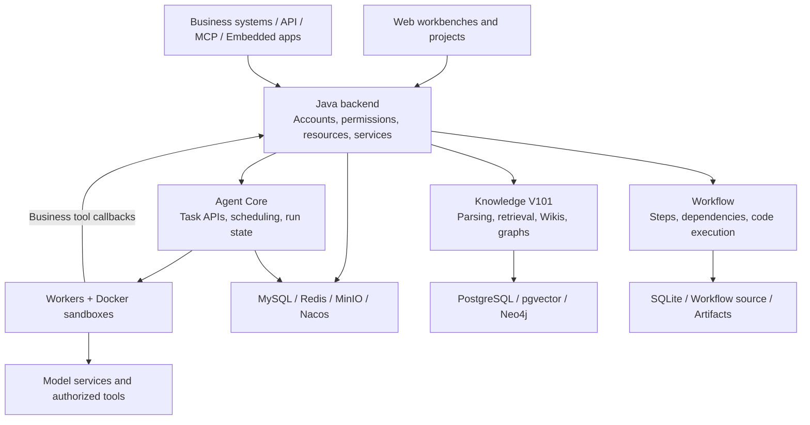

<p align="center">
  
</p>

<h1 align="center">NebuWork</h1>

<p align="center">A collaborative AI agent platform for domain-specific business tasks</p>

<p align="center">
  <a href="LICENSE"></a>
  
  
</p>

<p align="center"><a href="README.md">简体中文</a> · <strong>English</strong></p>

<p align="center">
  <a href="deploy/README.en.md">Deployment</a> ·
  <a href="#features">Features</a> ·
  <a href="#architecture">Architecture</a> ·
  <a href="#documentation">Documentation</a> ·
  <a href="#contributing">Contributing</a>
</p>

NebuWork brings business workbenches, expert agents, project resources, and task execution into one platform. Teams can turn domain knowledge, rules, standard operating procedures (SOPs), and tools into reusable capabilities.

Use the browser to organize documents, start tasks, inspect execution, and verify results. Publish configured capabilities as APIs, MCP services, or HTML pages to connect them to existing business systems. The Agent engine handles tasks that require reasoning, planning, and tool use; the Workflow engine executes processes with predefined steps.

Read the [product introduction (Chinese)](https://mp.weixin.qq.com/s/gM0Qrpks2OnQKDO66At48A) for the broader vision. The features and deployment instructions below describe the implementation in this repository.

## Features

- **Business workbenches**: Define domains, ontologies, terminology, entity relationships, task requirements, and expert configurations. Manage changes through drafts and published versions.
- **Project collaboration**: Organize conversations, files, artifacts, knowledge references, databases, and runtime resources around a project, with links between tasks and their outputs.
- **Expert agents**: Combine models, roles, SOPs, rules, knowledge bases, Skills, and MCP tools. Published resources support primary task execution and delegation to experts.
- **Agent and Workflow engines**: Run autonomous tasks and deterministic workflows in the same platform, with access to their status, logs, and outputs.
- **Knowledge processing and retrieval**: Import files, folders, and ZIP archives. Use document parsing, keyword and vector retrieval, Wikis, knowledge graphs, and image browsing to inspect supporting evidence. Track processing progress, pause work, retry failures, and rebuild results.
- **Persistent execution**: Separate engine APIs from Workers, persist run state, events, and checkpoints, and support concurrent Workers, tool traces, expert execution records, and additional human input.
- **Service publishing and integration**: Define input/output contracts, execution bindings, and releases to expose capabilities to API and MCP clients or embedded applications. Calls remain subject to enabled channels and resource authorization.
- **Access and usage tracking**: Manage account and resource access, encrypt stored credentials on the server, and record actual model calls and Token consumption. Expert participation reflects actual execution.

## Core concepts

NebuWork organizes business context and execution into four levels: workbench, project, expert definition, and agent run.

| Concept | Responsibility | Example |
| --- | --- | --- |
| Workbench | Define the rules, resources, and service entry points for a business domain | Procurement document review, contract review |
| Project | Manage documents, tasks, and outputs for a specific case, bound to a workbench business version | A procurement batch or a contract |
| Expert agent | Define reusable expertise and the resources it may access | A clause reviewer or technical documentation expert |
| Agent run | Hold the context, state, tool calls, and results of one execution | A review task or a delegated expert task |

Expert definitions are reusable; each execution keeps its own context and results. **Saving configuration, publishing resources, and executing a task are separate operations.** Adding an expert to a workbench does not publish that expert's runtime resources.

## Use cases

| Domain | Example tasks | Deliverables |
| --- | --- | --- |
| Procurement and tendering | Check document completeness, compare rules, retrieve technical references | Findings, source references, suggested changes |
| Contracts and policies | Compare clauses, identify conflicts, retrieve applicable rules | Clause review tables and items requiring confirmation |
| Business development and operations | Collect information, extract facts, query business data | Analysis reports and structured data |
| Engineering and specialist collaboration | Break down requirements, process documents, invoke tools, reuse workflows | Project documentation, artifacts, reusable processes |

These are configurable examples, not preinstalled industry solutions. They require suitable models, knowledge, experts, and rules. Domain specialists should verify task results against the underlying sources.

## Architecture



| Component | Technology | Directory |
| --- | --- | --- |
| Web application | React, Vite, JavaScript / TypeScript | [`frontend/`](frontend/) |
| Business and account services | Java 8, Spring Boot, MyBatis | [`backend/java/`](backend/java/) |
| Agent engine 2.0.0 | TypeScript, Node.js, Fastify, Docker | [`agent-core/v2.0.0/`](agent-core/v2.0.0/) |
| Workflow 3.5.0 | Python, FastAPI, SQLite | [`workflow/v3.5.0/`](workflow/v3.5.0/) |
| Knowledge service V101 | Go, Python, PostgreSQL / pgvector, Neo4j | [`knowledge/V101/`](knowledge/V101/) |
| Integrated development environment | Docker Compose, Nginx, initialization scripts | [`deploy/dev/`](deploy/dev/) |

## Quick start

See the [quick deployment guide](deploy/README.en.md) for complete startup, login, configuration, update, and troubleshooting steps.

### Prerequisites

- Install Git, or download the source from the current repository page, and open the repository root.
- Install and start Docker Engine / Docker Desktop with **Linux containers**.
- Use Docker Compose v2 with support for `docker compose up --wait`.
- Ensure access to container registries and build dependencies. Allocate resources for multiple services, document processing, and file storage. Models can run separately or use remote APIs.

Container builds install the component toolchains; you do not need Java, Node.js, Python, and Go together on the host. The first start builds images, so its duration depends on your network and hardware.

> These Compose files are for local development and evaluation. They use HTTP by default and expose some management interfaces to the local network. Before a public deployment, configure TLS, access controls, backups, and network isolation, and review Docker sandbox access and exposed management ports.

### Windows / PowerShell

Run from the repository root:

```powershell
.\scripts\Start-Dev.ps1
.\scripts\Get-DevAccess.ps1
```

The startup script generates separate credentials, starts databases and middleware, builds application and sandbox images, applies migrations, and initializes the administrator and engine, Workflow, and knowledge connections.

Open [http://localhost:18080](http://localhost:18080). The default administrator account is `admin`; `Get-DevAccess.ps1` prints the generated initial password.

Use `Start-Dev.ps1 -NoBuild` when the required images already exist. Rebuild affected images after changing their source.

<details>
<summary><strong>Linux / macOS: start with Docker Compose</strong></summary>

Run the following in Bash from the repository root. The sequence follows the PowerShell startup script. Platform compatibility depends on the container images; existing integrated validation for this repository uses Windows with Docker Desktop Linux containers.

```bash
set -e

docker run --rm --user "$(id -u):$(id -g)" \
  --mount "type=bind,source=$(pwd)/deploy/dev,target=/workspace/dev" \
  -w /workspace/dev node:22.19.0-slim node init.mjs

# Let Nginx Workers read the Workflow authentication file; keep .env private.
chmod 644 deploy/dev/generated/workflow-ui.htpasswd

component() {
  docker compose --env-file deploy/dev/.env -f deploy/dev/compose.component.yml "$@"
}
app() {
  docker compose --env-file deploy/dev/.env -f deploy/dev/compose.app.yml "$@"
}

component up -d --wait --wait-timeout 600 \
  mysql redis minio nacos knowledge-postgres knowledge-graph
component run --rm --no-deps init

docker build -t nebuwork-dev-sandbox:2.0.0 \
  -f agent-core/v2.0.0/deploy/sandbox.Dockerfile agent-core/v2.0.0
app build frontend backend engine-api1 workflow knowledge-v101 knowledge-v101-extraction
app up -d --wait --wait-timeout 900 \
  frontend backend engine-api1 engine-api2 engine-worker platform-mcp \
  workflow workflow-ui knowledge-v101 knowledge-v101-extraction
app run --rm --no-deps init
```

Open [http://localhost:18080](http://localhost:18080) and sign in with `DEV_ADMIN_ACCOUNT` and `DEV_ADMIN_PASSWORD` from the generated `deploy/dev/.env`. Do not commit that credentials file to Git.

</details>

### Run your first task

1. **Configure a model**: In Settings → Model settings, save the model endpoint, model name, and API key. Check the connection and select a default model. No real model credentials are bundled.
2. **Prepare an expert**: Create an expert and configure its role, model, and any knowledge, rules, SOPs, or extensions it needs. In the expert's Settings → Runtime settings, select **Save and publish resources**.
3. **Publish a workbench**: Create a workbench, define its business context, associate experts, and publish its business configuration and runtime resources. Mark knowledge, memory, or workflows as required only when the corresponding capabilities are connected and available.
4. **Create a project**: Create it from a published workbench, upload files or add knowledge references, and check document processing and access permissions.
5. **Start a task**: Open a conversation, specify the goal, inputs, and expected output, and inspect the execution trace, response, and artifacts. Verify the sources and conclusions.

For example, after preparing procurement documents and review references:

> Review the procurement documents in this project. Organize the results by document and clause location, issue, supporting evidence, and suggested change. Cite sources from the authorized knowledge base. List any missing information instead of assuming it.

A new run resolves published runtime resources. Existing runs and recovery use their original snapshots; publishing new resources does not rewrite historical execution records.

### Service endpoints and daily operations

| Service | Default endpoint |
| --- | --- |
| NebuWork | [localhost:18080](http://localhost:18080) |
| Native knowledge management UI | [localhost:18081](http://localhost:18081) |
| Workflow management UI | [localhost:18082](http://localhost:18082) |

Workflow uses separate login credentials. See the [development environment guide](deploy/dev/README.md) for all ports and account details.

```powershell
# Inspect application status and backend logs
docker compose --env-file deploy/dev/.env -f deploy/dev/compose.app.yml ps
docker compose --env-file deploy/dev/.env -f deploy/dev/compose.app.yml logs --tail 100 backend

# Stop services while keeping data
.\scripts\Stop-Dev.ps1
```

On Linux / macOS, run `docker compose --env-file deploy/dev/.env -f <compose-file> --profile preview stop` for both `deploy/dev/compose.app.yml` and `deploy/dev/compose.component.yml`.

Credentials are stored in the Git-ignored `deploy/dev/.env`, and application data uses separate Docker volumes. Back up credentials and data together: deleting credentials can prevent access to existing encrypted data, and `down -v` deletes volumes.

## Local development

Start the integrated development environment at the repository root, then work on individual components as needed. For frontend hot reload:

```powershell
cd frontend
npm ci
npm run dev
```

Open [http://localhost:5173](http://localhost:5173). The development server proxies requests to `http://127.0.0.1:18080` by default.

Run these checks from each component's directory after installing its dependencies:

| Component | Toolchain | Common checks |
| --- | --- | --- |
| `frontend/` | Node.js 22.19+, npm | `npm run check` |
| `backend/java/` | JDK 8+, Maven | `mvn clean verify` |
| `agent-core/v2.0.0/` | Node.js 22.19+, npm | `npm run typecheck`, `npm test`, `npm run build` |
| `workflow/v3.5.0/` | Python 3.12, uv | `uv run --frozen --extra server --extra dev --extra mcp python -m pytest -q` |
| `knowledge/V101/` | Go 1.26 | `go test ./...` |

Component startup scripts support independent development, but some defaults retain infrastructure settings from earlier migrations. For a fresh checkout, start with the root `scripts/Start-Dev.ps1`. Before running a component independently, configure your own connections and runtime directories according to its documentation.

## Documentation

Most component guides currently use Chinese.

| Guide | Contents |
| --- | --- |
| [Quick deployment](deploy/README.en.md) | Windows / Linux / macOS startup, initial configuration, updates, troubleshooting |
| [Integrated development environment](deploy/dev/README.md) | Docker, accounts, ports, configuration, persistence, validation |
| [Frontend](frontend/README.md) | Web application entry points and development commands |
| [Java backend](backend/java/README.md) | APIs, accounts, Nacos configuration, standalone startup |
| [Agent engine](agent-core/v2.0.0/README.md) | APIs, Workers, sandboxes, infrastructure connections |
| [Workflow](workflow/v3.5.0/README.md) | Workflow development, runtime directories, MCP, tests |
| [Knowledge integration](knowledge/V101/NEBUWORK.md) | V101 integration, authorization, uploads, retrieval, processing tasks |
| [Knowledge service development](knowledge/V101/README.md) | Native knowledge service and component configuration |

## FAQ

**Why is an expert missing from a task after I create it?**

Check that the project's bound business version includes the expert and that the expert's own runtime resources are published. Saving an expert profile or publishing a workbench does not publish expert resources. Start a new run after publication.

**Why does a task fail before a model call, with zero Tokens?**

Check model bindings, engine availability, and required business capabilities. A knowledge base needs an actual reference and access permission; memory needs a separately connected service. Selecting a required capability does not configure it. Some business validation errors may be wrapped as generic HTTP errors, so inspect the run records as well.

**Why are industry experts, models, and memory not preconfigured?**

The initial environment provides the platform and its core services. Users configure business workbenches and experts, supply model endpoints and credentials, and optionally connect memory. Components such as large Office document conversion also require separate activation; see the deployment guide.

## Contributing

Contributions are welcome: reproducible bug reports, documentation fixes, translations, integrations, and code improvements.

1. Use the current repository's Issues to report a problem or discuss a substantial feature. Include the version, environment, reproduction steps, and expected behavior.
2. Fork the repository and work in a separate branch. Keep each pull request focused on one issue.
3. Run checks for affected components. Add relevant tests for behavior changes and documentation for user-visible changes.
4. Submit a pull request explaining the purpose, validation results, and related Issue. Keep both language versions aligned when updating these READMEs.

Ensure you have the right to contribute the material under the project's license. Do not include real API keys, passwords, private environment configuration, user data, or software copyright registration materials. For vulnerabilities or leaked credentials, contact maintainers through an available private channel before sharing sensitive details in public Issues.

## License

Original NebuWork software is licensed under the [GNU Affero General Public License v3.0](LICENSE) (`AGPL-3.0-only`). Commercial use is allowed. Distribution and remote network interaction with modified versions carry the applicable notice, licensing, and Corresponding Source obligations. See [LICENSE](LICENSE) for the full terms.

This license applies only to code that the project's copyright holders are entitled to license under these terms. Third-party dependencies and copied or adapted upstream code retain their respective licenses and copyright notices. Check their compatibility and obligations when distributing the software.
