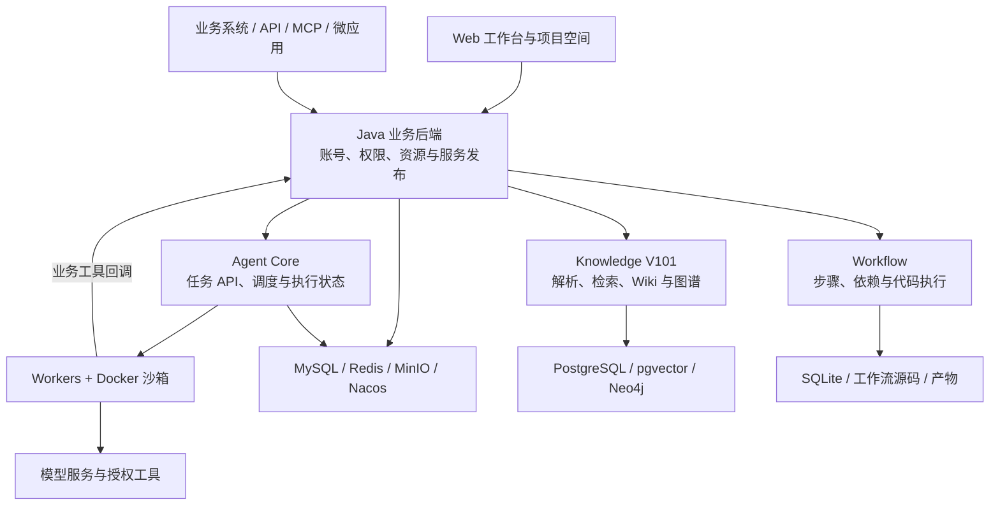

<p align="center">
  
</p>

<h1 align="center">NebuWork</h1>

<p align="center">面向专业业务的智能体协同工作平台</p>

<p align="center">
  <a href="LICENSE"></a>
  
  
</p>

<p align="center"><strong>简体中文</strong> · <a href="README.en.md">English</a></p>

<p align="center">
  <a href="deploy/README.md">快速部署</a> ·
  <a href="#核心能力">核心能力</a> ·
  <a href="#系统架构">系统架构</a> ·
  <a href="#文档导航">文档</a> ·
  <a href="#参与贡献">参与贡献</a>
</p>

NebuWork 将专业工作台、专家智能体、项目资源和任务执行组织在同一平台，帮助团队把业务知识、规则、SOP 和工具转化为可以反复调用的专业能力。

你可以在浏览器中组织资料、发起任务、查看执行过程和核验成果，也可以将配置好的能力发布为 API、MCP 或 HTML 页面，接入已有业务系统。Agent 引擎处理需要理解、规划和工具调用的开放任务，Workflow 引擎执行步骤明确的固定流程。

了解产品理念：[新一代企业级智能体平台——NebuWork](https://mp.weixin.qq.com/s/gM0Qrpks2OnQKDO66At48A)。以下功能与部署说明以本仓库实现为准。

## 核心能力

- **专业工作台**：定义业务领域、本体、术语、实体关系、任务规范和专家配置，通过草稿与发布版本管理业务变更。
- **项目化协作**：围绕项目组织任务会话、文件、成果、知识引用、数据库和运行资源，保留任务与产物的关联。
- **专家智能体**：组合模型、角色、SOP、规则、知识库、Skills 和 MCP 工具，通过已发布资源参与主任务或专家委派。
- **Agent 与 Workflow 双引擎**：在同一平台使用自主执行任务和确定性工作流，查看各自的状态、日志及输出。
- **知识处理与检索**：支持文件、文件夹和 ZIP 导入，结合文档解析、关键词与向量检索、Wiki、知识图谱及图片浏览核验来源；支持处理进度、暂停、重试和重建。
- **持久化任务执行**：引擎 API 与 Worker 分离，保存运行状态、事件和检查点，支持多 Worker 并发、工具轨迹、专家执行记录及人工补充输入。
- **服务发布与集成**：通过输入输出契约、执行绑定和版本发布，将业务能力提供给 API、MCP 客户端和微应用；调用受已启用渠道及授权范围约束。
- **权限与用量追踪**：管理账号和资源访问，服务端加密保存密钥，记录实际模型调用与 Token 消耗。专家参与统计以实际执行为准。

## 核心概念

NebuWork 按“工作台 → 项目 → 专家定义 → 运行实例”组织业务与执行。

| 概念 | 职责 | 示例 |
| --- | --- | --- |
| 工作台 | 定义一类业务的规则、资源与服务入口 | 采购文件编审、合同审查 |
| 项目 | 管理具体业务的资料、任务及成果，并绑定工作台业务版本 | 某批次采购、某份合同 |
| 专家智能体 | 定义可复用的专业能力及允许使用的资源 | 条款审查专家、技术文件专家 |
| Agent 运行实例 | 承载一次执行的上下文、状态、工具调用及结果 | 一次审查任务或专家子任务 |

专家定义可以复用，每次执行的上下文与结果独立记录。**保存配置、发布资源和执行任务是不同操作**；仅将专家加入工作台，不会自动发布该专家的运行资源。

## 应用场景

| 场景 | 可以组织的工作 | 可交付成果 |
| --- | --- | --- |
| 采购与招投标 | 文件完整性检查、规则核对、技术资料检索 | 问题清单、依据引用、修改建议 |
| 合同与制度审查 | 条款对照、冲突识别、适用规则检索 | 条款审查表、待确认事项 |
| 商机与经营分析 | 资料归集、信息提取、业务数据查询 | 分析报告、结构化数据 |
| 研发与专业协作 | 需求拆解、文档处理、工具调用、流程复用 | 项目文档、任务产物、可复用流程 |

这些是可配置的业务示例，需要准备相应的模型、知识、专家与规则，并非预装的完整行业解决方案。业务人员应结合来源资料核验任务结果。

## 系统架构



| 模块 | 技术栈 | 目录 |
| --- | --- | --- |
| Web 应用 | React、Vite、JavaScript / TypeScript | [`frontend/`](frontend/) |
| 业务与账号服务 | Java 8、Spring Boot、MyBatis | [`backend/java/`](backend/java/) |
| 智能体引擎 2.0.0 | TypeScript、Node.js、Fastify、Docker | [`agent-core/v2.0.0/`](agent-core/v2.0.0/) |
| Workflow 3.5.0 | Python、FastAPI、SQLite | [`workflow/v3.5.0/`](workflow/v3.5.0/) |
| 知识服务 V101 | Go、Python、PostgreSQL / pgvector、Neo4j | [`knowledge/V101/`](knowledge/V101/) |
| 集成开发环境 | Docker Compose、Nginx、初始化脚本 | [`deploy/dev/`](deploy/dev/) |

## 快速开始

完整的启动、登录、配置、更新和排障步骤见 [快速部署指南](deploy/README.md)。

### 环境准备

- 安装 Git，或从当前代码托管页面下载源码，进入仓库根目录。
- 安装并启动 Docker Engine / Docker Desktop，使用 **Linux containers**。
- 使用支持 `docker compose up --wait` 的 Docker Compose v2。
- 确保能够下载容器镜像及构建依赖，并为多服务运行、文档解析和文件存储预留资源。模型服务可以单独部署或使用远端接口。

容器部署会安装各模块的构建工具，无需在宿主机同时安装 Java、Node.js、Python 和 Go。首次启动会构建镜像，耗时取决于网络与机器性能。

> 以下 Compose 配置用于本地开发与功能验证，默认使用 HTTP，部分管理页面面向局域网开放。部署到公网前，应配置 TLS、访问控制、备份与网络隔离，并核对 Docker 沙箱及管理端口的暴露范围。

### Windows / PowerShell

在仓库根目录执行：

```powershell
.\scripts\Start-Dev.ps1
.\scripts\Get-DevAccess.ps1
```

启动脚本会生成独立凭据，启动数据库及中间件，构建应用和沙箱镜像，执行迁移，并初始化管理员及引擎、Workflow、知识库连接。

打开 [http://localhost:18080](http://localhost:18080)。默认管理员账号为 `admin`，随机初始密码由 `Get-DevAccess.ps1` 显示。

已有镜像时，可使用 `Start-Dev.ps1 -NoBuild` 启动；源码修改后应重新构建受影响的镜像。

<details>
<summary><strong>Linux / macOS：使用 Docker Compose 启动</strong></summary>

以下命令在仓库根目录的 Bash 中执行，对应 PowerShell 脚本的初始化与启动顺序。容器平台兼容性取决于所用镜像；本仓库的现有集成验证环境为 Windows + Docker Desktop Linux containers。

```bash
set -e

docker run --rm --user "$(id -u):$(id -g)" \
  --mount "type=bind,source=$(pwd)/deploy/dev,target=/workspace/dev" \
  -w /workspace/dev node:22.19.0-slim node init.mjs

# 允许 Nginx Worker 读取 Workflow 登录校验文件；.env 保持私有。
chmod 644 deploy/dev/generated/workflow-ui.htpasswd

component() {
  docker compose --env-file deploy/dev/.env -f deploy/dev/compose.component.yml "$@"
}
app() {
  docker compose --env-file deploy/dev/.env -f deploy/dev/compose.app.yml "$@"
}

component up -d --wait --wait-timeout 600 \
  mysql redis minio nacos knowledge-postgres knowledge-graph
component run --rm --no-deps init

docker build -t nebuwork-dev-sandbox:2.0.0 \
  -f agent-core/v2.0.0/deploy/sandbox.Dockerfile agent-core/v2.0.0
app build frontend backend engine-api1 workflow knowledge-v101 knowledge-v101-extraction
app up -d --wait --wait-timeout 900 \
  frontend backend engine-api1 engine-api2 engine-worker platform-mcp \
  workflow workflow-ui knowledge-v101 knowledge-v101-extraction
app run --rm --no-deps init
```

打开 [http://localhost:18080](http://localhost:18080)，使用生成的 `deploy/dev/.env` 中的 `DEV_ADMIN_ACCOUNT` 与 `DEV_ADMIN_PASSWORD` 登录。不要将这个凭据文件提交到 Git。

</details>

### 配置并运行第一个任务

1. **配置模型**：在“设置 → 模型设置”保存可用的模型接口、模型名和 API Key，检查连接并选择默认模型。仓库不预置真实模型密钥。
2. **准备专家**：创建专家，配置角色、模型及所需知识库、规则、SOP 或扩展。在专家“设置 → 运行设置”点击 **“保存并发布资源”**。
3. **发布工作台**：创建工作台，填写业务定义、关联专家，发布业务配置及运行资源。仅将已经接入并可用的知识库、记忆或工作流设为“必需业务能力”。
4. **建立项目**：从已发布工作台创建项目，上传文件或添加知识引用，确认资料处理状态及访问范围。
5. **提交任务**：创建会话，说明目标、输入和输出要求，查看执行轨迹、回复与成果文件，再核验引用和结果。

例如，在准备好采购资料和审查依据后，可以提交：

> 检查项目中的采购文件，按“文件与条款位置、问题、依据、建议”整理结果。引用已授权知识库中的来源；资料不足时列出需要补充的信息。

任务会在新一轮执行时解析已发布的运行资源。已有运行及故障恢复使用原快照，发布新的资源不会改写历史执行记录。

### 服务入口与日常操作

| 服务 | 默认入口 |
| --- | --- |
| NebuWork | [localhost:18080](http://localhost:18080) |
| 知识库原生管理页面 | [localhost:18081](http://localhost:18081) |
| Workflow 管理页面 | [localhost:18082](http://localhost:18082) |

Workflow 页面使用单独的登录凭据；完整端口与账号说明见 [开发环境文档](deploy/dev/README.md)。

```powershell
# 查看应用状态和业务后端日志
docker compose --env-file deploy/dev/.env -f deploy/dev/compose.app.yml ps
docker compose --env-file deploy/dev/.env -f deploy/dev/compose.app.yml logs --tail 100 backend

# 停止服务，保留数据
.\scripts\Stop-Dev.ps1
```

在 Linux / macOS 上，分别对 `deploy/dev/compose.app.yml` 和 `deploy/dev/compose.component.yml` 执行 `docker compose --env-file deploy/dev/.env -f <配置文件> --profile preview stop`。

凭据保存在 Git 忽略的 `deploy/dev/.env`，业务数据保存在独立 Docker 卷。备份时应同时保留凭据和数据；删除凭据会影响既有加密数据的读取，`down -v` 会删除数据卷。

## 本地开发

先启动根目录的集成开发环境，再按需要开发单个模块。前端支持热更新：

```powershell
cd frontend
npm ci
npm run dev
```

访问 [http://localhost:5173](http://localhost:5173)，开发服务器默认代理到 `http://127.0.0.1:18080`。

下列检查在对应模块目录运行，并需先安装该模块的依赖：

| 模块 | 开发工具 | 常用验证命令 |
| --- | --- | --- |
| `frontend/` | Node.js 22.19+、npm | `npm run check` |
| `backend/java/` | JDK 8+、Maven | `mvn clean verify` |
| `agent-core/v2.0.0/` | Node.js 22.19+、npm | `npm run typecheck`、`npm test`、`npm run build` |
| `workflow/v3.5.0/` | Python 3.12、uv | `uv run --frozen --extra server --extra dev --extra mcp python -m pytest -q` |
| `knowledge/V101/` | Go 1.26 | `go test ./...` |

模块级启动脚本支持独立开发，其中部分默认值保留了迁入时的基础设施配置。首次检出请优先使用根目录 `scripts/Start-Dev.ps1`；单独运行模块前，按其文档填写自己的连接和运行目录。

## 文档导航

| 文档 | 内容 |
| --- | --- |
| [快速部署](deploy/README.md) | Windows / Linux / macOS 启动、首次配置、更新与排障 |
| [集成开发环境](deploy/dev/README.md) | Docker、账号、端口、配置、数据持久化与验证 |
| [前端](frontend/README.md) | Web 应用入口与开发命令 |
| [Java 业务后端](backend/java/README.md) | API、账号、Nacos 配置和独立启动 |
| [智能体引擎](agent-core/v2.0.0/README.md) | API / Worker、沙箱与基础设施接入 |
| [Workflow](workflow/v3.5.0/README.md) | 工作流开发、运行目录、MCP 与测试 |
| [知识服务接入](knowledge/V101/NEBUWORK.md) | V101 集成、权限、上传、检索与处理任务 |
| [知识服务开发](knowledge/V101/README.md) | 原生知识服务与组件配置 |

## 常见问题

**已经创建专家，任务为什么看不到？**

核对项目绑定的业务版本是否包含该专家，以及专家自身的运行资源是否已经发布。保存专家资料或发布工作台，不等于发布专家资源。发布后重新发起一轮任务。

**任务在调用模型前就失败，Token 为 0？**

检查模型绑定、引擎状态和必需业务能力。知识库需要实际引用并具有访问权限；记忆需要单独接入服务。只勾选能力不会完成接入。部分业务校验错误可能被引擎包装为通用 HTTP 错误，应结合运行记录排查。

**为什么没有预置行业专家、模型或记忆服务？**

初始环境提供平台与基础服务，业务工作台和专家由用户配置。模型需要用户提供服务地址与凭据，记忆是可选外部服务；大文件 Office 转换等可选组件也需要单独启用，具体见部署文档。

## 参与贡献

欢迎提交问题复现、文档修订、翻译、集成适配及代码改进。

1. 通过当前仓库的 Issue 描述问题或讨论较大的功能改动，提供版本、环境、复现步骤和预期行为。
2. Fork 仓库，在独立分支完成修改，将一次 PR 聚焦于一个问题。
3. 运行受影响模块的检查；行为变更应附相应测试，用户可见变化应更新文档。
4. 提交 PR，说明变更目的、验证结果及相关 Issue；修改中英文首页时保持两种语言内容一致。

请确认你有权提交相关代码，并可按本项目许可证授权。不要提交真实 API Key、密码、私有环境配置、用户数据或软著申报材料。涉及安全漏洞或密钥泄露时，请先通过维护者提供的私密渠道联系，避免在公开 Issue 中披露敏感信息。

## 许可证

NebuWork 原创软件代码采用 [GNU Affero General Public License v3.0](LICENSE)（`AGPL-3.0-only`）。允许商业使用；分发及修改后提供网络交互服务时，应按协议履行相应的声明、授权及对应源码提供义务。完整条款以 [LICENSE](LICENSE) 为准。

本许可仅适用于项目著作权人有权按此协议发布的代码。第三方依赖及复制、改编的上游代码保留各自许可证和版权声明，分发时仍须核对其许可兼容性与义务。
