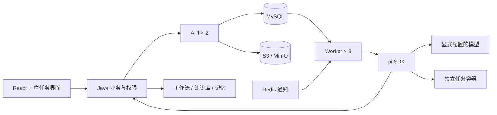

# 分布式智能体引擎

引擎使用官方 pi SDK 1.1.0 执行智能体循环。API 与 Worker 采用同一代码、不同容器角色。Java 只保存业务配置与任务关联，引擎数据库保存执行事实；两者只通过 HTTP 交互。

平台在“设置 → 智能体引擎”配置 API 节点；连接参数和加密凭据保存在 Java 业务数据库，不读取 Nacos 引擎连接项。Java 按请求轮询节点，仅对读请求和带稳定幂等键的写请求进行有界故障切换。API 每次核对平台固定的集群 ID 与对象存储指纹，防止节点误连其他数据库。`ae_cluster` 保存唯一集群 ID；`ae_workers` 保存 Worker 自动登记的心跳、执行容量和活动数量。管理页面通过受限接口读取节点状态，不负责部署或启动远程进程。

## 数据边界

Project 确定产物边界；Task 是 Java 业务任务；Session 保存单个智能体上下文；Run 是一轮执行；专家拥有独立 Session、Run 和工作区，parentRunId 关联主执行。一个会话只能有一个执行权。项目共享文件不授予会话内容读取权；读取其他任务对话需要目标会话绑定的 grant，撤销立即生效。

`ae_sessions` 保存 pi 原生条目、活动 leaf 和工作区检查点；`ae_runs` 保存输入、Manifest、租约和状态；`ae_events` 保存连续递增的会话事件；`ae_tools` 保存稳定工具调用 ID、意图、结果与恢复策略；`ae_requests` 实现请求幂等；`ae_outbox` 保存待通知事项；`ae_artifacts` 保存不可变版本元数据；`ae_bundles` 保存资源发布；`ae_grants` 保存会话授权。MySQL 是权威数据源，Redis 重启不丢执行。

## RuntimeManifest

每轮 Java 按工作台业务版本、最新已发布工作台资源、专家资源、项目资源、任务覆盖和本轮输入构造上下文。Manifest 包含身份、指令来源与作用目录、完整资源文件哈希、Skills 摘要与必需依赖、MCP、模型、专家、知识引用、记忆召回和镜像版本。Worker 补充实际镜像摘要并固定快照。

资源发布和项目业务发布相互独立。新轮次解析最新资源；同一 Run 恢复使用已保存的快照。访问权限在模型请求和工具执行前重新检查。`agent.md` 导入规范为 `AGENTS.md`；同路径冲突在发布时拒绝。目录指令在工具可用前加载并声明目录作用范围。必需技能全文预加载；普通技能按摘要发现、通过工作区工具读取完整 SKILL.md，脚本及素材保持相对路径。可选技能不可用时保存降级原因。

pi 使用内存 SessionManager；宿主机个人 pi 配置、Skills、模型凭据和 CLI 自动扩展不会进入执行。MCP 通过官方扩展显式初始化，HTTP 连接由系统声明，stdio 运行于任务容器。实际发现的工具目录保存到检查点；恢复发现目录变化时明确中断，要求新一轮重新解析。

## 持久化与恢复

Run 和 Outbox 在同一 SQL 事务提交。Worker 用 SKIP LOCKED 领取会话，使用递增 fencing token、30 秒租约、10 秒心跳。API 无节点亲和性，Worker 同时按节点容量和账号并发上限领取任务，等待专家时释放执行配额，恢复活动前重新取得账号和节点配额。Redis 通知加速唤醒，500 ms SQL 扫描兜底。

用户输入、模型请求前、完整工具意图、工具结果与工作区变更、压缩、专家委派和终态均经过持久化屏障。浏览器只接收已提交事件。恢复重新构造 pi 原生会话与活动分支；模型中途断流记录为新尝试，不能假装续接原流。

已完成工具复用持久结果；只读和明确幂等操作可恢复；外部写入优先按原调用 ID 核对；不能核对的操作进入 interrupted，展示“结果待核对”，不会自动重复写入。临时进程状态不恢复。父任务取消会取消所有未完成专家。

## 文件与运行容器

文件元数据引用 `artifactId + version`，正文保存为租户/账号分区下的内容哈希对象。上传及校验成功、SQL 元数据提交后发布 artifact.created。更新要求 baseVersion，旧版本保持可读。Run 接收附件时立即固定具体版本。HTTP 内容接口支持 Range、ETag 和下载；项目文件列表返回最新版本，版本历史单独查询。

每个 Run/恢复尝试使用独立容器，检查点重建任务工作区；专家工作区独立。CPU 2 核、内存 2 GiB、进程 256、工作区 tmpfs 512 MiB、单文件 32 MiB，均记录于 Manifest。容器内受保护的租约监视进程会在 Worker 停止续租后终止容器，工具进程仍为非 root。正式 HTTP 上传首版最大 20 MiB。大文件系统当前采用有界内存缓冲，不能把它宣传为无限大小的流式上传。模型密钥仅存在 Worker 的内存请求参数中，不进入文件工具或命令环境。

## 契约与可观察性

版本化契约位于 `contracts/v1`，`npm run contracts:export` 从同一 Zod/Fastify 声明导出。SSE 使用会话 sequence 和 Last-Event-ID，历史快照带对应 cursor；重复/迟到事件由 React reducer 去重排序。父事件流只显示专家委派及摘要；专家详情读取子会话。

`/v1/metrics` 输出队列等待、上下文准备、模型首字、工具耗时、恢复、对象读取失败、真实模型用量和运行状态。模型响应未提供用量时记录未知；不推算账单。生产模型能力、独立业务引擎的部署和连接权限仍需使用真实配置验收。
