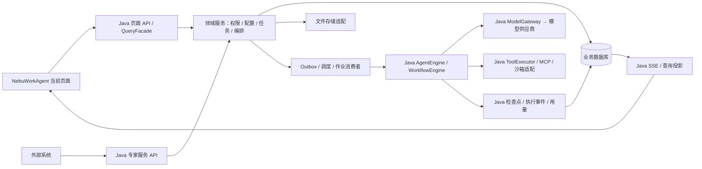
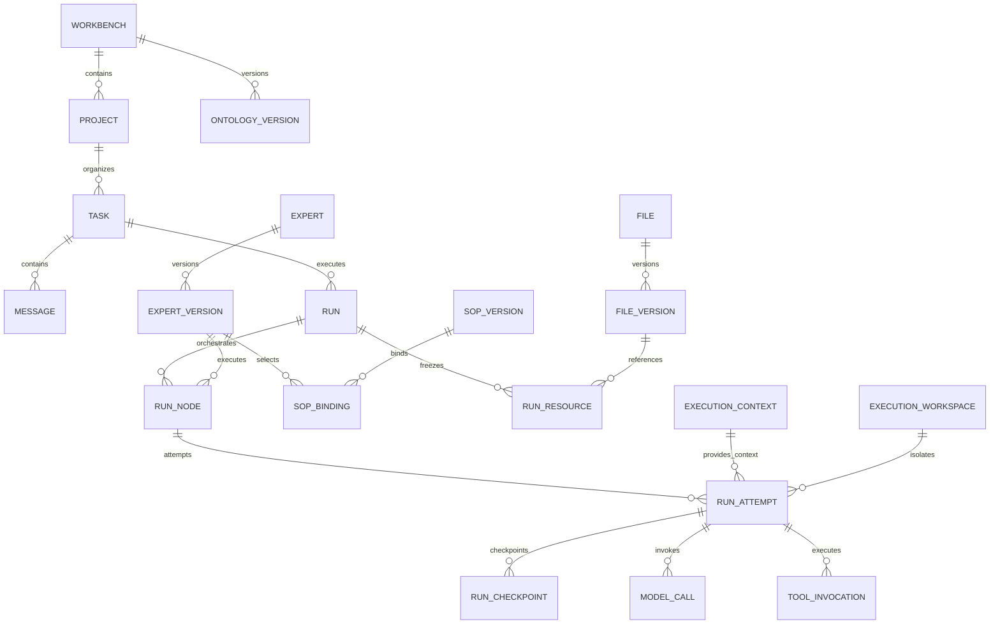

> 2026-10-15：本文保留为历史阶段记录。当前执行链路、部署与验收以 [新智能体引擎交付说明](agent-engine-delivery.md) 为准；文中的旧核心、模板和未接通状态不适用于当前实现。

# NebuWork 页面对齐的数据结构与 Java 后端设计

> 日期：2026-09-19｜状态：设计提案，尚未实施。
> 约束：以当前 NebuWorkAgent 页面和操作流程为准；保留菜单、路由、Tab、弹窗、三栏任务页和操作顺序。后端代码统一集中于 nebuwork-backend-api；本轮仅维护设计文档。
> 架构更新（2026-09-20）：业务后端使用 Java，智能体内核位于 NebuAgentCore，NebuWorkAgent 为纯前端。以下涉及“将执行引擎迁入 Java”的内容是历史草案，已被本条取代，不作为实施依据。本批仅统一登录和用户信息接入，参见 unified-auth-migration.md。
> 依据：当前页面源码、types.ts、contracts.ts、httpApi.js、Node BFF、Core 源码，以及用户提供的三份需求文档。文档中的旧技术栈和 M1/M2/M3 不是本次实施授权。

## 1. 设计结论与“不改页面逻辑”的边界

采用“现有页面 DTO + Java 业务模型 + NebuAgentCore 执行内核”的职责划分。以下详细执行模型仍是待重新对齐的历史设计，不代表已实现。

- 页面继续使用 workbenches、projects、agents、sessions、messages、todos、files 等现有对象名称。
- Java 按页面组装返回值；持久化模型按业务关系拆分，不把整个 window.DB 存成一份 JSON。
- 前端 session 对应业务任务 Task；一次发送、重跑或追问对应一次业务 Run；一次 Run 可以包含多个专家执行节点。
- Java 管理业务对象及持久化，NebuAgentCore 承担内核执行；二者的任务、上下文与运行映射后续另行对齐。
- 配置内容用版本与执行快照固定；消息、事件、用量保留来源和发生顺序。
- 当前页面可用操作有对应后端契约；目前明确不支持的删除消息/回退等动作保留其边界。暂时没有入口的需求单独标识，不擅自增加导航或页面。

“不改页面逻辑”不等于未来前端一个字符都不改。当前部分按钮只修改 DB 数组、假下载使用 Blob、部分图表使用固定公式；单独替换服务器无法使这些动作持久化。未来允许的必要接入改动是：

1. 按钮点击、弹窗字段与跳转不变，将内存写操作替换为 API，成功后刷新当前数据。
2. 保留现有 View 的数据形状，由 API 适配器填充客户端缓存；缓存不再充当权威数据源。
3. 保留现有组件与布局，把写死的统计值、占位下载、连接结果改为服务器数据。
4. 多专家选择先保存到服务端，再允许发送；表格仍按行列点击，但写请求用稳定行列 ID。
5. 原来没有发布、审批或编排策略入口的能力，不宣称仅增加后台表就完成了产品功能。

本轮不执行以上代码改动。

## 2. 当前页面作为契约

| 页面/现有入口 | 保留的交互 | 页面需要的数据 | Java 领域 |
| --- | --- | --- | --- |
| 登录、头像菜单 | 登录、退出、个人信息、主题 | authenticated、user、权限摘要、quota | 身份会话、成员、用量；主题可继续本地保存 |
| 工作台首页与统计 | 卡片、项目入口、统计图 | workbenches、projects、sessions、usage | 工作台查询与统计投影 |
| 专业工作台配置 | 编辑定义、添加/移除知识库、专家、案例 | bizName、domain、bizDef、kbRefs、agentIds、tplIds | 本体版本及三类绑定 |
| 项目列表 | 工作台筛选、搜索、创建、状态筛选 | Project[] | 项目管理 |
| 项目详情 | 概览、任务、记忆、文件、知识库、数据库、定时任务、扩展、情报、资源统计 | 原 ProjectDetail 聚合结果 | 项目资源聚合 |
| 任务三栏页 | 会话切换、发送、专家多选、附件、停止、删除、待办、文件、上下文、审计 | 原 SessionDetail 聚合结果和 SSE | 任务、执行、资源与事件 |
| 专家列表/详情 | 创建、概览、SOP、知识库、扩展、参与任务、消耗、引用模板、规则 | Agent、SopSet、AgentRule 等 | 专家能力管理 |
| SOP 编辑 | workflow 节点拖拽、增删改；process 资料、规范、步骤 | wf.nodes / proc.materials、specRefs、steps | SOP 草稿、版本、结构验证 |
| 规则库 | 新建规则集、规则、编辑、启停、删除 | RuleSet[]、AgentRule[] | 规则版本及专家绑定 |
| 广场 | 案例使用、扩展安装、专家雇佣、知识库引用 | 四类卡片及各自操作状态 | 发布目录、版本引用、安装作业 |
| 设置 | 个人信息、模型、频道、执行体、扩展授权、用户设置 | user、providers、channels、executors、extAuth、users | 配置、连接器、发行物、权限与审批 |
| 顶栏搜索/通知 | 搜索任务消息、已读、删除、跳转 | 授权搜索结果、个人通知 | 查询、通知状态 |
| 指挥官/情报 | 对话、调度列表、节点、订阅开关、地图 | commander、intelSubs、intelItems、projectIntel | 命令意图、任务投影、情报订阅 |

### 2.1 当前没有完整入口的需求

| 需求 | 数据与服务如何设计 | 页面处理 |
| --- | --- | --- |
| 非会话批量、任务组合 | Batch + Strategy + Task + Run | 可由后台/API 产生任务并在现有任务列表展示；独立批量创建向导仍需单独确认入口 |
| 文件监听、协作留言板 | Listener + FileEvent + CollaborationMessage | 保留后台能力；不把任务内待办伪称为完整协作空间 |
| 个人独立会话、服务调用 | Task.execution_scope = personal / service | 不伪造普通业务项目塞进项目列表；当前任务页依赖 projectId，个人空间展示需另行适配 |
| 微应用、系统目录 | MicroAppVersion、SystemEntry | API/模型预留，现有菜单不新增 |
| 实例镜像管理、云电脑 | RuntimeImage、RuntimeInstance、ResourceSample | 与设置中的“执行体下载”分开，不把下载卡片当沙箱管理页 |
| 动态重定义页面 | 可选 UiSchemaVersion、组件白名单、数据绑定声明 | 本轮不启用动态渲染、不替换当前页面 |
| 专家、本体等发布审核 | 通用 Approval + 不可变版本 | 当前保存动作只保证草稿持久化；未接发布入口时不能偷偷当作已审核发布 |

## 3. Java 后端结构与数据归属

沿用本地 Maven 工程声明的 Java / Spring Boot / MySQL / MyBatis 体系设计，不在本轮升级或新增依赖。父 POM 中的 MySQL 版本为客户端依赖版本，不能据此确定服务器版本。

建议先做一个按领域组织的 Java 模块；API、调度器和执行任务消费者可作为同模块的不同运行角色部署。无需为每张表拆微服务。

建议包结构，全部位于 cn.nebulaedata.cccs.nebuwork.backend.api：

    common/       错误、请求上下文、ID、时间、分页
    identity/     用户、租户、成员、会话、授权
    workbench/    工作台、本体、引用配置
    project/      项目、成员、资源绑定、记忆
    expert/       专家、版本、SOP、规则、经验
    task/         任务、消息、Run、执行节点、待办
    orchestration/策略、批次、调度、监听、意图
    resource/     文件、知识库、数据连接与数据表
    runtime/      Java Agent/Workflow 引擎、上下文、检查点、执行事件
    tool/         Java 工具注册、权限检查、MCP 客户端、沙箱适配
    model/        供应商、模型、路由、凭据引用
    governance/   审批、审计、用量、预算、告警
    market/       案例、发布目录、安装与引用
    intelligence/情报订阅与项目关联
    integration/  频道、微应用、外部系统、执行体发行
    query/        页面 DTO、聚合查询、展示格式

每个领域内按 controller / application / domain / infrastructure 组织。Controller 接收命令与返回 DTO；业务事务由 application 服务完成；Mapper 不直接暴露给页面。

### 3.1 统一数据归属

Java API 与 Java worker 使用同一套领域契约和持久化模型。执行任务可以独立进程部署，但不引入另一套 Python 服务或外部内核业务数据库。

| 数据 | 权威方 | 执行侧处理 |
| --- | --- | --- |
| 租户、用户、工作台、业务项目、专家/SOP/规则/策略版本 | Java 业务库 | Java 引擎读取本次执行冻结的配置 |
| 业务任务、选中专家、Run、编排、审批授权、预算 | Java 业务库 | Java worker 在租约内更新状态和检查点 |
| 模型消息、工具调用、执行事件 | Java 执行记录 | 按 task/context/attempt 关联；同库生成页面查询投影 |
| 用户发送消息 | Java 先持久化 | 引擎引用消息 ID；供应商请求/响应不重复创建用户消息 |
| 文件与文件版本 | Java 文件目录及存储适配 | 沙箱按授权快照取得输入；输出校验登记后成为业务成果 |
| 人工待办覆盖、成员配置、产品记忆 | Java 业务库 | 不改写原始执行事件或 Agent 待办快照 |
| 用量 | 供应商原始响应与 Java 模型调用记录；账本在 Java | 按调用 ID 去重；缺失数据保留未知状态 |

执行 worker 不可用时，已有业务查询仍可工作；执行命令明确排队或失败，不生成演示回复。Agent/Workflow 引擎、解析/校验和工具适配均使用 Java 实现，不通过 Python 脚本或 FastAPI 包装层补足运行能力。

## 4. 数据建模规范

以下 nw_ 是建议表前缀；表名属于设计，不是已存在的数据库对象。

### 4.1 公共字段与类型

- 主键及对外 ID 为字符串，支持保留历史 ID；不要求前端识别 ID 前缀。具体生成器由现有 Java 工程规范决定。
- 租户内实体包含 tenant_id。用户全局身份可由既有身份源提供，成员关系必须归属租户。
- 可编辑实体含 created_at、updated_at、created_by、updated_by、revision；更新使用 revision 做乐观锁。
- 时间按 UTC 存储，API 的原始时间使用 ISO 8601；cron 另存 IANA timezone。
- 字节数、Token 原值使用整数；费用使用定点 decimal，API 输出十进制字符串；未知与零分开。
- 核心引用和可筛选字段独立列。SOP 定义、Schema、快照、扩展参数可用 JSON；实际数据库 JSON 类型支持未验证，DDL 阶段确认，必要时使用经校验的文本列。
- 版本表以 entity_id + version 唯一，发布后不可修改；对同一实体只允许一个活动草稿或明确 draft 分支。
- 页面中的“今天”“18KB”“1.2K”“¥…”由 QueryFacade 生成，同时返回原始数值；不得把这些展示字符串作为计量来源。
- 数据删除按类型区分：普通资源归档/回收，消息与文件按留存策略清理，审计按政策保留最小字段。软删除不等于永久保留原文。

### 4.2 多租户及关联约束

所有租户内的主实体提供 (tenant_id, id) 唯一键；关键关联以组合外键或同等事务校验确保同租户。查询从可信登录/服务账号上下文确定 tenant_id，不接受客户端任意指定租户。

工作台/项目与专家、知识库、案例、扩展的关系使用显式绑定表，不用逗号串或单列数组作为关系真源。API 可以继续返回 agentIds、kbRefs 等数组。

跨资源授权单独记录 action、grantee、resource、有效期与范围。知道文件 ID、工作区 ID 或拥有工作台入口权限均不等于有权读取所有资源。

### 4.3 核心关系

图中的 Project→Task 只表示 project scope；personal/service scope 的任务不归属业务项目。执行上下文与工作区分别保存，工作区记录不代表已经创建容器；实例隔离由 Java 的运行环境适配器落实。

## 5. 按页面设计业务表

### 5.1 工作台与项目

| 建议表 | 核心字段 | 约束/用途 |
| --- | --- | --- |
| nw_workbench | id、name、icon、color、description、default_expert_id、active_ontology_version_id、status | 对应现有工作台卡片；六个现有工作台作为配置，不写死在 Java switch 中 |
| nw_ontology_version | workbench_id、version、biz_name、domain、biz_definition、wiki_md、system_prompt、entities_json、relations_json、applicability_json、exclusions_json、status、content_hash | 保留 bizName/domain/bizDef；补充字段不要求当前页面立即展示 |
| nw_workbench_agent / knowledge / case | workbench_id、target_id、pinned_version_id、sort_order | 分别保存专家、共享知识、案例引用；同一对象去重 |
| nw_project | id、workbench_id、name、description、status、owner_id、default_strategy_version_id、budget_policy_id、origin | status 保留 active/paused/archived；origin=live/legacy_demo |
| nw_project_member | project_id、member_id、role_id | 资源级权限 |
| nw_project_agent / knowledge / extension | project_id、target_id、pinned_version_id、sort_order | 项目级覆盖/引用；执行时冻结有效版本 |
| nw_project_memory | project_id、category、content_md、source_task_id、source_run_id、source_refs_json、status、revision | category 映射经验/规则/偏好/背景；自动总结先 draft |
| nw_project_memory_version | memory_id、version、content_md、source_refs_json、published_by | 保存人工修改与批准历史 |

工作台本体与资源引用修改不改变已启动任务。普通名称/说明保存可直接生效；影响执行的本体/SOP/规则通过版本发布生效。当前页面没有发布按钮，需要另接管理 API/既有授权流程后才可使用新版本，不能隐式放宽审批。

项目 stats、工作台 projectIds/running/tokenToday 都是查询结果，不在主表保存一份可被页面覆盖的统计对象。

### 5.2 专家、SOP、规则和经验

| 建议表 | 核心字段 | 约束/用途 |
| --- | --- | --- |
| nw_expert | id、name、initials、color、role_label、tagline、owner_id、active_version_id、status、entry_kind | 页面继续叫 agent；entry_kind 区分普通专家与工作台默认专家入口 |
| nw_expert_version | expert_id、version、engine_type、system_prompt、input_schema_json、output_schema_json、ui_output_json、model_route_version_id、permission_policy_json、status、content_hash、ability_bundle_ref | engine_type=agent/workflow；版本固定依赖；能力包由 Java 加载 |
| nw_sop / nw_sop_version | expert_id、name；sop_id、version、kind、description、definition_json、markdown、status | kind=process/workflow，保留当前两种编辑形态 |
| nw_expert_sop_binding | expert_version_id、sop_version_id、is_default、sort_order | 支持一个专家多个 SOP；执行必须解析到明确版本 |
| nw_expert_knowledge / extension / case | expert_version_id、target_version_id、binding_config_json | 运行时使用批准的精确依赖 |
| nw_rule_set | expert_id、name、description | 页面 scene 应转换成稳定 rule_set_id；不使用可改名称作外键 |
| nw_rule / nw_rule_version | rule_set_id、name、active_version_id；rule_id、version、content、condition_json、severity、applicability_json、source_refs_json、enabled、status | enabled 与发布状态分开；启用草稿不能参与正式执行 |
| nw_rule_hit | rule_version_id、run_node_id、evidence_ref、result、occurred_at | 支持页面 hits 统计与依据回溯 |
| nw_experience_draft | expert_id、source_run_ids_json、summary_md、evidence_json、status、reviewer_id | 从任务回流，批准后才纳入后续专家版本 |
| nw_expert_growth_event | expert_id、event_type、source_id、score_delta、rule_version、occurred_at | level/xp 按可追溯规则计算；评分规则未定时不伪造成长值 |

当前 workbench-employee:<workbenchId> 是页面用的虚拟专家 ID。兼容层可解析到 nw_workbench.default_expert_id；执行快照记录真实 expert_version_id。它不是运行实例，不能给它单独发一份重复用量。

#### SOP 的存储与执行契约

process 页面原结构保留：

    proc.materials[] / proc.specRefs[] / proc.steps[{t,d,sys,rpa}]

内部补充材料文件版本 ID、规范版本 ID、步骤 ID。名称是展示值；数组下标不能作长期引用。

workflow 页面原结构保留：

    wf.source / wf.rules / wf.input / wf.output / wf.nodes[{t,d,x,y}]

内部定义：

    schema_version
    nodes[{id,type,title,description,input_mapping,output_schema,config,position:{x,y}}]
    edges[{id,from,to,condition}]
    aggregation / failure_policy

当前画布只有标题、说明、位置及列表顺序，不能凭 x/y 推导业务执行顺序。兼容旧数据可保存线性展示草稿；只在用户/预置模板明确了节点类型与依赖后生成可执行版本。未知节点不能直接转为任意 shell/代码执行。

SOP 是专家内部规程；Strategy 是项目任务如何组合专家。二者分表，不能因页面都有“步骤”而合并。

### 5.3 任务、消息、Run 与多专家执行

| 建议表 | 核心字段 | 约束/用途 |
| --- | --- | --- |
| nw_task | id、project_id nullable、owner_id/service_account_id、title、task_type、execution_scope、trigger_source、display_kind、status、latest_run_id、latest_execution_run_id、default_strategy_version_id、origin | 前端 session.id 即 task.id；任务不是某次模型请求 |
| nw_task_agent | task_id、expert_id、preferred_version_id、sort_order、is_primary | 保存页面多选顺序和首位专家；新 Run 冻结版本 |
| nw_message | task_id、run_id nullable、attempt_id nullable、sequence、role、content_json、content_text、client_message_id、source_type、source_message_key、created_at、visibility | (tenant_id,task_id,sequence) 唯一；内部模型/工具消息按上下文引用，不默认展示 |
| nw_message_attachment | message_id、file_version_id、role | 关联稳定文件版本 |
| nw_run | task_id、parent_run_id nullable、retry_of_run_id nullable、purpose、status、strategy_version_id、snapshot_json、snapshot_hash、budget_reservation_id、idempotency_key、started_at、finished_at、error_json | 一次用户执行请求或系统触发；purpose=execute/followup/retry |
| nw_run_resource | run_id、resource_type、resource_id、resource_version_id、role、content_hash | 冻结本体、专家、SOP、规则、知识索引、输入文件和模型路由 |
| nw_run_node | run_id、node_key、expert_version_id nullable、sop_version_id nullable、node_type、status、input_json、output_ref、dependency_json、attempt_count | (run_id,node_key) 唯一；节点不等于任务列表新增一行 |
| nw_run_attempt | run_node_id、attempt_no、context_id、workspace_id、instance_id nullable、status、dispatch_key、lease_owner、lease_until、fencing_token、started_at、finished_at、error_json | (run_node_id,attempt_no) 唯一；Java worker 直接执行并保存失败尝试，状态不依赖外部 Core Run |
| nw_run_event | run_id、sequence、type、node_id、attempt_id、source_event_key、payload_json、occurred_at | (run_id,sequence) 和 source_event_key 唯一；用于 SSE 补读 |
| nw_task_todo_snapshot / nw_task_todo_item | task_id、run_id、plan_id、revision；snapshot_id、item_key、text、status、detail、sort_order | 原始 Agent 待办快照不可改；按当前 Run 最新有效版本展示 |
| nw_todo_override | task_id、run_id、plan_id、item_key、status、operator_id、revision | 人工覆盖仅作用于相应 Run/plan，不继承到新 Run |
| nw_run_context_ref | run_id、resource_type、resource_version_id、locator_json、access_scope、summary | 上下文面板、引用、检索证据来源 |
| nw_message_feedback | message_id、user_id、rating、comment、updated_at | (tenant_id,message_id,user_id) 唯一；rating=helpful/unhelpful；再次点击/切换更新同一用户反馈 |

建议内部任务维度：

    task_type: conversation | batch | scheduled | service
    execution_scope: project | personal | service
    trigger_source: user | schedule | listener | api | microapp | expert
    display_kind: normal | cron

task_type 表达产品分类，trigger_source 表达谁触发，execution_scope 表达归属和访问边界。scheduled 可以引用 batch 型策略，策略决定拆分方式；不可凭 display_kind 判断执行逻辑。

project scope 必须有 project_id，service/personal scope 不得伪造业务 project_id；分别要求服务账号/个人所有者。服务任务由服务 API 接收，在项目列表、项目搜索、项目 SSE 和下载入口均不能越域访问。

状态兼容：

| 业务/运行状态 | 页面 task.status | currentRun.status / SSE |
| --- | --- | --- |
| queued、validating、retry_wait | waiting | queued；阶段细节另存 |
| running | running | running |
| waiting_approval | waiting_approval | waiting_approval |
| completed | done | completed / run.completed |
| failed | failed | failed / run.failed |
| cancelled | cancelled | cancelled / run.cancelled |
| interrupted | interrupted | interrupted / run.interrupted |
| paused | paused | 当前兼容 Run 不新增未知状态；通过任务状态表达 |

根 Run 完成由全部必需节点及聚合规则决定；不能收到第一个专家 completed 就关闭前端订阅。partial_failed 属于批次结果汇总，不直接注入当前页面未识别的枚举。

追问创建 purpose=followup 的 Run，指向原执行 snapshot 与成果版本，权限限定为只读。latest_run_id 可指向最近追问供会话恢复，latest_execution_run_id 保留正式成果所属执行；追问不重置原任务待办和成果。

### 5.4 文件、知识库和项目数据表

| 建议表 | 核心字段 | 约束/用途 |
| --- | --- | --- |
| nw_folder | project_id、parent_id、name、area、sort_order | area=source/artifact/diagnostic；校验同项目与无环 |
| nw_file | project_id nullable、owner_id、folder_id、name、current_version_id、origin、status | 稳定逻辑文件；不将服务器路径当文件 ID |
| nw_file_version | file_id、version、storage_key、size_bytes、sha256、media_type、upload_status、scan_status、parse_status、created_at | 原内容不覆盖；只有满足扫描/解析策略的版本可执行 |
| nw_task_file | task_id、file_version_id、role、source_run_id | 输入/输出关系；同一文件可关联多个任务 |
| nw_artifact | run_id、run_node_id、attempt_id、file_version_id、artifact_kind、publish_status、origin_event_key | Java 统一注册成果；普通成果、诊断文件、内部待办分开 |
| nw_file_parse_job | file_version_id、parser_version、status、result_ref、error、attempts | 上传成功与解析成功独立 |
| nw_knowledge_base | owner_scope、owner_id、name、description、source_type、connector_id、active_index_id、visibility | 项目自有、专家/工作台引用、共享均使用同一个知识库对象 |
| nw_knowledge_document | knowledge_base_id、file_version_id、status | 同一 KB + 文件版本唯一 |
| nw_knowledge_index / nw_knowledge_chunk | KB、version、embedding_config_version、status；index_id、file_version_id、locator_json、text_ref、vector_ref | 检索前限定授权范围；页码/段落可追溯 |
| nw_wiki_version | knowledge_base_id/workbench_id、version、content_md、source_refs_json、status | 保留来源和审核状态 |
| nw_data_connection | project_id、name、engine、mode、endpoint_config_json、credential_ref、capabilities_json、status、last_tested_at | mode=managed/external；凭据不返回前端 |
| nw_data_table | connection_id、name、schema_revision、external_locator、capabilities_json | 内部托管表与真实外部表共享展示模型 |
| nw_data_column | table_id、column_key、name、type、nullable、validation_json、sort_order | 不以列标题作为不可变 ID |
| nw_data_row | table_id、row_key、values_json、revision | 仅存 managed 数据；外部行不复制成另一份可写真源 |
| nw_data_change | connection_id、table_id、row_key、before_ref、after_ref、actor、status | 外写审计、冲突与审批；按实际能力启用 |

数据库页面仍可显示 columns[] 与 rows[][]。接口额外返回 tableId、columnIds[]、rowIds[]、rowRevisions[]；点击坐标先在适配层转换为稳定 ID，再提交更新。不能提交“第 3 行第 2 列”后在数据库盲改，排序/并发会改错数据。

外部连接不默认获得建表或写权限。只读连接的现有按钮操作由服务器拒绝并使用现有错误提示；不得在 UI 显示成功但只改缓存。任意 SQL 不作为当前页面接口。

文件树由 folder/file 组装；task.files、project.files、kbDocs 是相同文件版本的不同视图，不分别复制出三套文件记录。

## 6. 编排、自动化与治理表

以下是完整需求的逻辑模型；按服务依赖逐组落地，不要求首次建库同时创建所有表。

| 领域 | 建议表与关键字段 | 关键约束 |
| --- | --- | --- |
| 任务策略 | nw_strategy、nw_strategy_version：workbench/project、version、stages_json、input/output schema、failure_policy、status | stages 明确专家版本、依赖、条件、聚合；发布不可变 |
| 批量 | nw_batch：project_id、strategy_version_id、split_mode、resource_snapshot、status；nw_batch_item：batch_id、task_id、input_key | (batch_id,input_key) 唯一；任务状态汇总，不重复计量 |
| 定时 | nw_schedule：project、strategy_version、cron_expr、timezone、enabled、overlap_policy、misfire_policy；nw_schedule_occurrence：schedule_id、scheduled_at、task/batch_id、status | (schedule_id,scheduled_at) 唯一；启停是服务器状态 |
| 监听 | nw_listener、nw_listener_version：scope/filter/threshold/exclusions/strategy/budget；nw_file_event；nw_listener_match | 唯一匹配键 tenant + project + listener_version + file + file_version |
| 协作 | nw_collaboration_message、nw_command_intent：project/task、text、actor、proposed_action、target_snapshot_hash、status | 普通留言不直接执行；意图确认后调用相同领域命令 |
| 模型 | nw_model_provider、nw_model、nw_model_route_version：credential_ref、provider/model、capabilities、tier、constraints、fallbacks | 模型页面配置统一进入运行路由；连接测试不等于推理可用 |
| 身份 | nw_tenant、nw_user（或身份源映射）、nw_tenant_member、nw_role、nw_permission、nw_role_permission、nw_member_role、nw_resource_grant、nw_login_session | 菜单开关映射有限动作集合，不能变成全部项目/敏感上下文访问权 |
| 服务账号 | nw_service_account、nw_service_key、nw_service_grant：key_hash、allowed_experts/resources、quota、expiry | 入站 key 安全哈希；出站 provider secret 使用 credential_ref |
| 审批 | nw_approval、nw_approval_decision：target_type/id/version/hash、action、requester、scope、expiry、decision | 禁自批、绑定对象版本与参数；审批后事务写恢复作业，由 Java worker 幂等恢复 |
| 审计 | nw_audit_event：actor、action、resource、outcome、trace_id、task/run/node、redacted_diff | 追加写；上下文敏感读取也记审计 |
| 用量 | nw_usage_event：source_key、task/run/node/attempt、expert/model、input/output/cached tokens、measurement_status、cost、currency、price_version | 同一模型调用一次入账；未知不按 0 处理 |
| 预算 | nw_budget_policy、nw_budget_reservation、nw_budget_entry：scope、limit、reserved、settled、root_run_id | 预留及扣减原子执行；子专家继承根预算 |
| 告警 | nw_alert_rule、nw_alert：rule_version、source_event、severity、status、dedupe_key | 失败、用量、权限、实例等均有来源；重复告警去重 |
| 案例/市场 | nw_case_template、nw_case_version、nw_market_item、nw_market_reference、nw_extension、nw_extension_version、nw_extension_install_job | 案例复制配置不复制秘密/权限；安装完成以执行结果为准 |
| 频道 | nw_channel_connection、nw_channel_inbound_event、nw_channel_delivery | 外部消息 ID 去重；凭据引用；发消息遵守动作权限 |
| 情报 | nw_intel_subscription、nw_intel_item、nw_project_intel：source_id/url、published_at、collected_at、evidence、location、score_version | 地图坐标为展示数据；热度、来源、时间必须可解释 |
| 通知 | nw_notification、nw_notification_recipient：event_key、user、read_at、hidden_at | 删除/已读为用户级，不能删掉其他用户通知 |
| 执行体发行 | nw_executor_release：platform、arch、version、artifact_ref、checksum、signature、status | 只返回真实可下载发行物；未发布不可生成假文件 |
| 运行资源 | nw_runtime_image、nw_runtime_instance、nw_runtime_resource_sample | 镜像摘要、运行位置、租约、心跳、CPU/内存采样及时间；无实例提供方时标 unavailable |
| 微应用/系统 | nw_microapp、nw_microapp_version、nw_microapp_invocation、nw_system_entry | 专家版本、表单/输出 schema、调用权限；前端不持服务密钥 |
| 可配置界面 | nw_ui_schema_version（可选）：owner、version、layout、components、bindings、status | 仅注册组件与受控数据源；保留模型但当前页面不切换 |
| 可靠投递 | nw_outbox、nw_inbox、nw_idempotency、nw_dispatch_job | 事务写业务与 outbox；消费去重、请求摘要、租约、失败补偿 |

需为常用查询建立组合索引：任务列表 (tenant_id,project_id,status,updated_at,id)、消息 (tenant_id,task_id,sequence)、事件 (tenant_id,run_id,sequence)、待触发计划 (enabled,next_fire_at)、待投递作业 (status,next_attempt_at)、用量 (tenant_id,occurred_at,project_id/expert_id)。具体索引随真实查询计划确认，不预先为每个 JSON 字段建索引。

## 7. 页面 DTO 与内部表的适配

### 7.1 保留响应包装和现有 URL

现有成功响应保持：

    {"code":0,"data":{...}}

错误保持真实 HTTP 状态和可读 msg，并可增加 errorCode、traceId、retryable。字段兼容由 Java QueryFacade 处理；不同时维护两套业务逻辑。

现有 /api 前缀保留。内部数据库 snake_case 与页面 camelCase 通过 DTO 转换。新增无头服务可使用 /api/v1/service，避免把 service scope 放进 /api/projects 查询。

### 7.2 关键聚合返回值

WorkbenchConfigView：

    bizName / domain / bizDef
    kbRefs[] / agentIds[] / tplIds[]
    revision / draftVersion / activeVersion / publishStatus

ProjectDetailView 保留：

    project / sessions[] / memories[] / files[] / fileTree[]
    knowledgeBases[] / databases[] / cronJobs[] / usage
    extensions[] / intel[] / approvals[]

SessionDetailView 保留：

    legacy / project / session / projectSessions[]
    messages[] / runs[] / events[] / audit[] / browser[] / context[]
    files[] / artifacts[] / todos[] / approvals[]
    todoEditable / todoRunId / todoWarning

AgentDetailView 保留 agent / tasks / growth；可追加 sopSets / ruleSets / rules / knowledgeBases / extensions / templates / usage，由前端 API 层归一化到现有 DB 键。所有资源加载均经过后端授权，不能先返回所有租户数据再靠缓存过滤。

### 7.3 全局数据加载

当前 DB 还保存 users、sharedKbs、plazaTemplates、notifications、quota、channels 等。建议：

- GET /api/bootstrap：当前用户、权限、可用工作台、基础能力标记和必要展示配置。
- 各页面分别加载领域列表；ProjectDetail/SessionDetail 保留现有聚合调用，减少改动。
- API 适配层为项目数据库表、知识库文档、专家 SOP/规则做预取或按需缓存；View 的导航逻辑不变。
- 全局搜索由 /api/search 查询授权的任务和消息，不再只搜索已经加载到浏览器的内容。
- 退出或切租户时清理全部用户数据缓存和 SSE 订阅。

已有列表接口继续返回数组；新增 cursor/limit 和 nextCursor 元信息需适配层配合。不能静默只返回前若干条却让页面显示“全部”。当前不支持分页的页面先维持完整小规模结果，超出响应限制明确报错；规模化时追加加载属于数据接入工作，不能声称后端可无限返回全部消息。

### 7.4 展示统计口径

| 页面字段 | 真源/口径 |
| --- | --- |
| project.stats.tasks | 项目可见主任务数量；子任务是否单独显示由同一列表规则决定 |
| project.stats.tokens / session.tokens | 对相应 scope 的去重 usage_event 求和；缓存量是否含 input 由供应商字段定义 |
| agent.stats.tasks / successRate | 明确统计“参与的已终态任务”或“调用”，分别返回 taskCount/invocationCount，不混用 |
| agent.stats.tokens / cost | 归属实际执行专家的调用用量 |
| workbench.stats.running | 下属项目当前未终态执行的任务数 |
| quota / usage 趋势 | 预算账本与按日用量投影，不继承 Mock 常量 |
| growth.level / xp | 可追溯成长规则；未启用时返回未配置，显示层使用占位文本 |
| CPU/内存 | 真实实例采样值和 sampleAt；未知/过期单独标识 |

父 Run/批次不另加一份子执行用量。价格未知时 cost 为 null，页面兼容字符串可为“--”；已知总量不完整时同时返回 completeness。Java ModelGateway 从首次调用就记录 measurement_status；供应商未返回 usage 时标 unknown。迁移旧 Core 的零值若无计量证据，也不能认定为实际零消耗。

## 8. API 设计：先兼容，再补齐页面写操作

### 8.1 原有接口整体承接

下列接口由 Java 保持现有响应形状、HTTP 语义、Cookie 和 SSE 习惯：

| 接口组 | 原有路径/操作 |
| --- | --- |
| 认证（当前） | 统一用户服务 POST /web/punterapi/login、/loginOut、/power/getPunterPowerInfoInHeader；环境前缀 /nebulaedev |
| 状态/文档 | /api/health、/api/integration、/api/docs、/api/openapi.json |
| 工作台 | GET /api/workbenches |
| 项目 | GET/POST /api/projects；GET/PATCH /api/projects/{id} |
| 任务 | GET/POST /api/projects/{id}/sessions；GET/DELETE /api/sessions/{id} |
| 执行 | POST /api/sessions/{id}/runs；GET /api/projects/{p}/runs/{r}；POST .../cancel、.../resume |
| SSE | GET /api/projects/{p}/runs/{r}/events，支持 Last-Event-ID |
| 待办 | GET /api/sessions/{id}/todos；PATCH /api/sessions/{id}/todos/{todoId} |
| 文件 | POST /api/projects/{id}/files；GET .../artifacts；GET .../artifacts/{a}/preview、.../content |
| 审批 | GET /api/projects/{id}/approvals；POST .../approvals/{a}/decision |
| 专家 | GET/POST /api/agents；GET /api/agents/{id} |
| 模型 | GET/POST /api/model-providers；POST .../models、.../test、.../{id}/test；DELETE .../{id} |
| 扩展申请 | POST /api/ext-auth；POST /api/ext-auth/{id}/review |

现有 raw file body + X-File-Name 上传方式先保留，由 Java 转为内部文件记录；后续大文件直传可另加接口。历史 confirm=true 删除语义继续保留，并检查活动 Run、权限和留存策略；前端移除不等于无条件物理删除审计。

### 8.2 将当前内存动作对应为真实命令

| 当前页面动作 | 建议接口 | 请求/结果要点 |
| --- | --- | --- |
| 编辑工作台本体 | GET/PATCH /api/workbenches/{id}/config | 原 bizName/domain/bizDef + revision；返回保存后的草稿 |
| 添加/移除工作台引用 | POST/DELETE /api/workbenches/{id}/bindings/{kind}[/{targetId}] | kind 白名单；校验引用权限和版本 |
| 项目专家/扩展/知识引用 | POST/DELETE /api/projects/{id}/bindings/{kind}[/{targetId}] | 同租户和授权资源 |
| 项目记忆维护 | GET/POST /api/projects/{id}/memories；PATCH /api/memories/{id} | 来源、revision；生成草稿与发布分开 |
| 保存任务多选专家 | PATCH /api/sessions/{id} | {agentIds,revision}；活动 Run 不受修改影响 |
| 助手消息重试 | POST /api/sessions/{id}/runs（兼容扩展） | purpose=retry、sourceRunId；新建 Run 并记录 retry_of_run_id，原执行与费用保留 |
| 消息有帮助/没帮助 | PUT /api/messages/{id}/feedback | {rating}；保持现有按钮，反馈按当前用户持久化 |
| 专家编辑 | PATCH /api/agents/{id} | 非执行属性更新；执行属性创建版本草稿 |
| SOP 列表/新增/保存/删除 | GET/POST /api/agents/{id}/sop-sets；PATCH/DELETE /api/sop-sets/{id} | 保持现有 wf/proc 形状；返回稳定节点 ID |
| SOP 资料上传 | POST /api/sop-sets/{id}/materials | 文件版本引用，不只保存文件名 |
| 规则集与规则 | GET/POST /api/agents/{id}/rule-sets、.../rules；PATCH/DELETE /api/rules/{id} | ruleSetId + 原 scene 展示字段；启停审计 |
| 知识库及文档 | GET /api/knowledge-bases；POST .../connections；GET/POST /api/knowledge-bases/{id}/documents | 上传、同步、索引分别返回状态 |
| 数据连接 | GET/POST /api/projects/{id}/data-connections；POST .../{c}/test | 凭据仅写入；返回能力与实际连接结果 |
| 数据表/行列 | GET/POST /api/data-connections/{c}/tables；GET/POST /api/data-tables/{t}/rows；PATCH .../rows/{r} | 稳定列 ID、row revision、类型校验 |
| 定时启停 | PATCH /api/projects/{p}/schedules/{id} | {enabled,revision}；由服务器更新 nextRun |
| 案例使用 | POST /api/market/cases/{id}/use | 创建明确绑定案例版本的项目/策略；不固定绑定 wb-doc |
| 扩展安装 | POST /api/market/extensions/{id}/install | 返回 installationId/status；尚未完成不得 toast 安装成功 |
| 专家雇佣 | POST /api/market/experts/{id}/adopt | 明确为授权引用还是派生副本，记录来源版本 |
| 共享知识引用 | POST /api/market/knowledge/{id}/references | targetScope/targetId；显式授权 |
| 个人信息/用户权限 | PATCH /api/me；GET /api/users；PATCH /api/users/{id}/permissions | 权限开关映射服务端权限，不接受越权赋予 |
| 频道连接 | POST /api/channels/{id}/connect、.../disconnect | 真实连接状态；外部 OAuth 按适配器实现 |
| 执行体下载 | GET /api/executor-releases；GET /api/executor-releases/{id}/download | 真实文件与签名状态 |
| 情报订阅 | GET /api/intelligence；PATCH /api/intelligence/subscriptions/{id} | 服务端持久化 enabled |
| 指挥官输入 | POST /api/commander/messages | 回复及结构化意图；调用正常授权的项目/任务服务 |
| 搜索/通知 | GET /api/search、/api/notifications；PATCH/DELETE /api/notifications/{id} | 当前用户授权范围和个人已读状态 |

未来发送接口可向后兼容地增加 expectedTaskRevision、purpose、sourceRunId。当前多选仅修改本地数组，因此接入时必须串行保存选择并等待成功再发送，避免“屏幕选 B，服务器运行 A”。

消息复制继续使用浏览器剪贴板，不需要后端。当前真实消息删除与回退会明确提示不支持，本设计保持这一行为，不新增可破坏原始执行历史的接口。若以后开放回退，应在 Java 中新建执行上下文分支、固定消息边界并记录来源；不能仅隐藏页面消息而让引擎继续读取旧上下文。用户点击重试与系统自动重试分开：前者新建业务 Run，后者在原节点下新建 attempt；两者都保留来源和用量。重试的输入快照由 sourceRunId 明确引用，不依赖浏览器再次拼装旧附件。

### 8.3 完整需求的后台 API

- 批量：POST /api/projects/{id}/batches、GET /api/batches/{id}、POST /api/batch-items/{id}/retry。
- 策略：/api/strategies、/api/strategies/{id}/versions、.../publish。
- 监听：/api/projects/{id}/listeners、.../versions、.../publish、.../matches。
- 专家发布：/api/agents/{id}/versions、/api/expert-versions/{id}/publish。
- 审批：/api/approvals、/api/approvals/{id}/decisions；原 ext-auth 是同一审批服务的兼容入口，但不能绕过其类型/权限校验。
- 独立服务：POST /api/v1/service/experts/{id}/invocations；GET /api/v1/service/runs/{id}、.../events、.../artifacts。
- 治理：/api/usage、/api/audit-events、/api/alerts、/api/runtime/instances。

缺少页面入口的接口保留为后台/API 能力；入口接入待另行确定。

## 9. Java 智能体执行引擎与一致性

### 9.1 Java 引擎组件与执行数据

AgentEngine 和 WorkflowEngine 都在 nebuwork-backend-api 内实现，可由独立 Java worker 进程运行同一模块的执行代码。它们共享 RunContext、权限、预算、工具注册、检查点和事件契约。

| Java 组件 | 职责 |
| --- | --- |
| AgentEngine | 组装上下文、调用模型、解析工具请求、执行/等待审批、继续循环、校验最终输出 |
| WorkflowEngine | 按已发布 DAG 运行确定的节点依赖、条件与聚合；不让模型自由改写流程 |
| ModelGateway | 供应商协议适配、流式响应、工具/结构化输出能力校验、超时取消和计量 |
| ToolRegistry / ToolExecutor | 注册工具 Schema、风险与幂等属性；验证参数、权限、审批、预算及执行范围 |
| McpClient / SkillLoader | Java MCP 客户端及 Markdown/Schema 能力包加载；不加载 Python 执行脚本 |
| ContextAssembler | 按专家版本、消息分支、授权资源及上下文窗口生成模型输入 |
| CheckpointService | 保存执行阶段、待完成调用和可恢复状态；审批等待不占用执行线程 |
| ExecutionEventWriter | 在事务内写业务事件和状态，输出现有前端 SSE 契约 |
| WorkspaceManager / SandboxProvider | 由 Java 管理输入挂载、输出登记、实例创建回收、资源与网络边界 |
| DocumentParser / OutputValidator | Java 文档提取、Schema/业务校验和成果生成；OCR 等依赖通过明确的适配接口接入 |

补充的数据表：

| 表 | 内容 | 唯一性/范围 |
| --- | --- | --- |
| nw_execution_workspace | tenant、scope、task_id、expert_version_id、storage_ref、snapshot_hash、status、expires_at | 默认每次 attempt 独立可写目录；跨租户/任务不得共享可写工作区 |
| nw_execution_context | task_id、expert_version_id、branch_id、parent_context_id、revision、status | 同一任务的不同专家分别保留上下文；通过明确引用传递结果 |
| nw_context_message_ref | context_id、message_id、position、source_snapshot_hash | 固定上下文消息成员及顺序；不得默认把其他专家全部内部消息合并 |
| nw_context_summary | context_id、through_position、summary、source_hash、summary_model_call_id | 摘要有来源；原始消息不因压缩而丢失审计引用 |
| nw_run_checkpoint | run_attempt_id、step_no、phase、context_revision、state_json、created_at | (run_attempt_id,step_no,phase) 唯一；恢复从已确认阶段继续 |
| nw_model_call | run_attempt_id、step_no、call_no、request_key、provider_request_id、provider/model、input_ref、output_ref、status、usage_json、measurement_status、error | 每次实际供应商请求有独立记录；显式记录重试和未知结果 |
| nw_tool_invocation | run_attempt_id、step_no、tool_call_id、tool/version、arguments_hash、arguments_ref、risk、idempotency_key、approval_id、status、result_ref、error | 以 attempt + 工具调用 ID 去重；网络超时不等于未执行 |
| nw_external_id_alias | entity_type、source_system、source_scope、external_id、business_id | 仅用于历史导入及旧链接兼容，不作为新的运行链路 |

新运行不需要 core_project_id、core_thread_id、core_run_id。旧 ID 只保留在迁移别名/来源元数据中。历史运行可以查询，但不能把未完成的 Python 内存执行状态直接当作 Java 检查点恢复。

持久上下文可以跨同一任务的串行 Run 复用；文件工作区默认按 attempt 隔离，只挂载快照允许的输入与明确引用的旧成果。容器/进程隔离、回收和工具进程取消由 Java SandboxProvider 落实，不能只靠工作目录证明沙箱隔离。

### 9.2 一次发送的服务端流程

1. 校验用户、项目状态、成员权限、专家引用和文件范围；project.paused 不接受新执行。
2. 幂等校验：同一主体、端点、key、请求摘要返回同一结果；同 key 不同内容 409。
3. 锁定任务配置 revision，解析明确的专家/SOP/策略版本；冻结全部输入资源和模型路由。
4. 同一数据库事务写入用户消息、业务 Run、执行节点、预算预留和 outbox，返回 202。
5. Java worker 在租约内领取节点作业，准备执行上下文和工作区，由 AgentEngine 或 WorkflowEngine 直接执行。
6. 每次模型/工具调用先登记调用记录，再访问供应商/工具；响应后事务保存消息、调用结果、计量、检查点及根 Run 事件，更新查询投影。
7. 产物事件先验证来源/大小/摘要并登记文件版本，登记完成后才向页面发可访问的 artifact.created。
8. 所有节点结束后执行汇总规则，结算实际用量/释放预算，发根 Run 终态与通知。
9. 失败、取消、进程重启和网络断开通过状态对账继续处理；不依赖浏览器保持在线。

模型、工具及存储的外部副作用不纳入 Java 数据库事务。网络超时不能直接认定远端未执行。保留请求键，在明确支持幂等的端点使用同一键恢复；无法确认时将对应调用标记 outcome_unknown 并对账，禁止重新换键重复执行外部副作用。模型供应商不支持幂等/查询时也不能宣称恰好调用一次；重试作为独立调用计量，可能已发生但未知的费用保留未知状态。

### 9.3 多专家与 Workflow

- 仅一个专家且无策略时，可执行该专家已发布默认 SOP。
- 多选专家只表达参与者，不能凭选中先后或名称推断串并行、条件和汇总方法。
- 建议工作台/项目绑定显式默认 Strategy。页面多选对该策略的参与者进行校验；未配置兼容策略返回可理解的 422，不能偷偷执行第一个专家。
- 默认策略若采用“并行分析→主专家汇总”，必须保存为可查看、可审核的策略版本；这是产品选择，不视为本轮已确认。
- Java WorkflowEngine 负责 DAG 调度、条件、重试、审批、聚合和预算；expert 节点调用 Java AgentEngine 或另一已发布 Workflow，LLM 节点通过 ModelGateway 单次调用，tool 节点通过 ToolExecutor 执行。
- Agent 循环与固定 Workflow 是两个明确的 Java 执行入口；单纯把 DAG 文本放进提示词不算实现 Workflow。
- Java AgentEngine、WorkflowEngine、ModelGateway、ToolExecutor 尚待实现；在相关执行原语通过验证前，节点类型不能标记可运行，也不回退调用旧 Python 服务。
- Agent 自行提出调用其他专家时也须进入 Java 的调用网关，继承父权限与剩余预算，并记录父子节点；禁止绕过调度直接自发无限互调。

### 9.4 SSE 兼容与多专家归并

现有前端读取 id、type、run_id、thread_id、sequence、created_at、data，并依据根 Run 的终态停止读取。Java 统一输出业务 ID：

    id: 业务事件 ID
    run_id: 业务根 Run ID
    thread_id: 业务 Task ID（兼容字段名）
    sequence: 根 Run 单调序号
    data: 保留页面所需事件字段，追加 nodeId、expertId、attemptId

多个 Java worker 的节点事件不能用各自本地序号直接混在一条流中。ExecutionEventWriter 通过数据库中的根 Run 序号计数器、事务与唯一约束分配 sequence；重试以 source_event_key 去重。Last-Event-ID 按业务根序号补读，事件不依赖进程内计数器。

子专家事件通过 node/tool 类型展示；只有最终呈现的助手回复使用 message.delta/message.completed，避免多个专家文字被现有页面拼成同一条消息。节点结束不转发为根 run.completed。若以后需要并排流式展示多专家回答，属于另外的页面能力。

事件保留窗口、过期补读和查询快照接口一起设计。旧客户端尚无 410 恢复逻辑时不能直接启用短保留策略；接入层需增加“过期后重新获取 SessionDetail”的数据恢复处理。

### 9.5 可靠调度

业务数据库 outbox + 可领取作业表可承担首版可靠调度；消息中间件可通过适配器后接，不假定 Java 合集中已配置某队列。

- 作业状态、租约和 fencing token 持久化；旧 worker 丧失租约后不得提交有效结果。
- 领取过程采用事务与条件更新，具体 SQL 按真实数据库版本验证。
- 全局、租户、专家、模型、项目配额从持久化或分布式计数实施，不能只靠 JVM Semaphore。
- 暂停项目/计划、撤权和取消在发起下一步工具/专家调用前重新检查。
- 执行失败重试新建 attempt；仅重试可证明安全的操作。人工确认的不可幂等外写不自动重放。
- 定时触发写 occurrence 唯一键；重叠、补跑、时区政策明确配置，不以 Java 定时注解本身保证唯一执行。
- 文件监听仅消费满足策略的解析完成事件，排除产物、防循环、按文件版本去重；历史补扫为单独命令。

### 9.6 Agent 循环、恢复与运行限制

AgentEngine 的每一步先校验取消、租约、权限、剩余预算、步数和截止时间，再从已冻结版本及执行上下文构造模型请求。ModelGateway 将流式输出转换为现有 message.delta 事件，并记录真实供应商请求 ID 与计量。

模型提出工具调用后，ToolExecutor 校验已注册工具、参数 Schema、资源范围及审批要求。需要审批时持久化工具调用与检查点，把状态设为 waiting_approval 并释放执行槽；审批后重新领作业、重新校验授权，从等待点恢复。成功工具结果作为相应上下文的工具消息，供下一步模型读取。最终结果通过专家输出 Schema 和业务校验后，才产生根 Run 完成事件。

worker 重启时按调用与检查点状态恢复：尚未开始的调用可以执行，结果已落库的调用直接复用，结果未知的非幂等工具需对账或人工处理。取消停止新调用，并尽力终止当前 HTTP 请求/工具进程；无法撤销的远端动作记录实际状态及已发生费用。

供应商 SDK/HTTP 客户端的隐式重试不能绕过 nw_model_call 与预算账本；每次可计费请求均记录。技能中的提示词、SOP、JSON Schema 可迁移为数据，旧 Python 校验/成果脚本需要实现为 Java 工具后才可启用。工具执行白名单不得为了兼容旧脚本增加 Python 解释器回退路径。

## 10. 审批、上下文和用量的实施边界

### 10.1 统一审批

Java ApprovalService 管理“谁有权批准什么”，Java AgentEngine/WorkflowEngine 保存等待点。审批决定与恢复 outbox 同事务保存；worker 校验批准对象、租约和检查点后幂等恢复，确认已应用后标记 applied。尚未恢复时不能展示“正在执行”。

审批绑定 tenant、调用者、专家/SOP版本、工具、参数摘要、文件范围、权限范围与有效期。修改任一关键参数后重新审批。发布审批与 Java 工具调用审批使用同一审计链，但不能把工具批准当成专家上线批准。

现有六类模板有 full_access 配置；迁移时必须转换为与业务授权相匹配的 Java 权限策略，不能原样导入即授予全部权限。审批检查在每次 ToolExecutor 执行前强制实施，不能仅靠提示词要求模型自行审批。

### 10.2 上下文与数据回流

任务上下文面板来自文件、知识检索、数据库引用、浏览来源和公开执行事件。记录真实消息和工具摘要，不要求保存或展示模型隐藏思维链。

回流流程：成功/失败执行→筛选授权材料→生成规则/经验/记忆草稿→人工审核→新版本发布。复用某次任务的原始文件需重新检查授权；默认不能让跨项目经验夹带原文或凭据。

### 10.3 用量账本

计量以 nw_model_call 中每次实际模型调用为粒度，包含所有失败/重试/追问/子专家调用；原调用的统计维度是账本标签，不另产生扣费事件。旧 Core Run 的累计 Token 仅可作为历史导入数据；若缺调用级明细，应标记来源粒度与不完整性，不能与新调用明细重复入账。

迟到计量与冲正追加事件，不覆盖历史。模型价格快照与实际模型名一起记录。阶段预估用于预算预留，不能显示成实际费用。价格、缓存 Token 关系、预算和限额在接真实模型前明确配置。

## 11. 现有能力参考与 Java 重实现清单

| 内容 | 可复用基础 | 必须补充/验证 |
| --- | --- | --- |
| 页面 DTO | types.ts、contracts.ts、httpApi.js、现有 OpenAPI | 缺失的配置/表格/市场接口与原始计量字段 |
| 旧客户端与 SSE 契约（待重新对齐） | 旧 Node 客户端已移除，历史实现可从 Git 查阅 | Java 与 NebuAgentCore 的执行接口后续单独实施 |
| 模板、Skill、校验脚本 | workbench-core 六类业务模板、SOP 与结果 Schema | 提示词/Schema 作为数据迁移；Python 校验和成果脚本重写为 Java，不能直接调用 |
| Agent 执行行为 | 旧 Core 的工具循环、幂等、取消、恢复与审批逻辑 | Java AgentEngine、检查点、调用账本与权限执行重新实现并验证 |
| Workflow | 页面已有 SOP 结构及文档中的 DAG 需求 | Java WorkflowEngine 直接实现依赖、条件、并行、审批与聚合 |
| 模型、MCP 与工具 | 旧 Core 中的协议和能力清单 | Java ModelGateway、McpClient、ToolExecutor；不依赖 Python 桥接进程 |
| 文件/成果 | 旧 Core 上传、产物协议；Node 镜像和预览行为 | Java 文件版本、解析/校验、成果生成、权限与存储统一实现 |
| 待办 | 快照 schema、plan/revision 校验、人工覆盖 | 持久化到业务表，保留最新 Run 和完成后人工编辑规则 |
| 测试 | BFF 与前端已有契约/资源隔离测试 | Java 对同一契约的结果验证；不能用 Mock 通过替代真实集成 |

## 12. 迁移顺序与验收

这里是依赖顺序建议，不是用户已经确认的 M1/M2/M3 或工期。

1. **冻结当前页面契约**：整理完整请求、响应、状态、空值、错误、SSE、下载及所有直接 DB 写入口。
2. **Java 业务基础与页面兼容 API**：登录、项目任务、文件、待办和配置持久化；保留 /api 及页面数据形状，执行入口在引擎完成前明确不可用。
3. **Java 原生执行闭环**：实现 ModelGateway、AgentEngine、ToolExecutor、上下文、检查点、审批、用量和 SSE；用单专家任务验证，不采用 Java 代理 Python 作为过渡完成标准。
4. **接通当前页面配置写入**：工作台本体、专家/SOP/规则、知识库、数据库、定时启停、市场、用户和设置。
5. **补齐 Workflow、多专家与自动化**：Java DAG 引擎、策略、节点、批次、监听和后台调度；缺页面入口的先提供 API，不宣称 UI 已交付。
6. **统一企业治理**：权限、审批、账本、告警、版本发布与回流贯穿以上步骤落地，按真实业务场景验收。
7. **切换纯前端 + Java 部署**：浏览器 /api 指向 Java；API/调度/执行均为 Java 运行角色，前端只产出静态资源。迁移核对后移除 Node BFF 与 Python/FastAPI 服务的运行依赖；Node 仅作为前端构建工具。

### 12.1 历史数据迁移

- origin=legacy_demo 的旧种子保留只读演示标识；不把示例用户、权限、成本导入真实业务账本。
- 旧 Core 的真实项目、Thread、Run、消息、产物迁移为 Java 业务/历史执行记录，保留来源 ID 别名；重复导入不得产生重复任务或用量。新运行不再创建任何旧 Core 对象。
- 切换前排空旧运行；无法完成的任务保存中断状态，待授权后以明确的新 Java Run 继续。旧工具结果未知时先对账，不直接重放，也不尝试恢复 Python 进程内状态。
- 现有 Node 的 artifact mirror 与 todo-overrides 需校验文件摘要和 Run 归属后迁移；不能只迁数据库丢掉人工待办状态。
- 真实迁移时先停止或排空写操作，按检查点复制、核对数量与关联，再切换唯一写入方；本轮不读取/迁移生产运行数据。
- 保留原 task/project URL 可用；对于 ID 改变通过别名解析，拒绝有歧义的跨来源 ID。
- 切换后不做 Node 和 Java 无协调双写。回滚前先评估切换后的新增业务写入如何保留，不能直接指回旧库造成丢失。

### 12.2 验收重点

- 页面路由、Tab、弹窗字段、三栏布局与用户操作顺序不变。
- 所有保存/引用/安装/连接类操作以服务端结果为准，刷新、重启后状态一致。
- 专家选择改变真实执行对象，选中的精确版本可在 Run 快照和审计查到。
- 同一任务的文件、待办、审批和消息不串到其他任务；跨租户 API/SSE/下载均拒绝。
- 多专家执行只有一个正确的根终态，事件断线补读无重复文本。
- 重试不重复创建业务 Run 或重复执行未知结果的外写；服务重启有可解释恢复状态。
- 外部服务任务不进入业务项目列表，但在授权专家统计/管理员审计可见。
- 实际、估算、未知用量与费用区分；多维统计无重复扣费。
- 内存占位操作、固定图表数值和假下载已替换；未接入能力保持明确错误/不可用状态。
- 前端静态部署后，后端仅部署 Java 运行角色；关闭旧 Node BFF 和 Python/FastAPI 服务后，登录、单专家/多专家执行、工具审批、事件续传、文件与用量闭环仍通过验收。
- 所有迁移后的业务模板均无需 Python 解释器、脚本或桥接服务；仅移植业务规则/协议不能作为执行能力验收通过的证据。

## 13. 尚需确认的产品/架构决定

这些决定不阻止当前设计评审，但对应能力实施前需要明确：

后端统一 Java、不使用 Python 已确认，不再作为待定选项。

1. 多选专家的默认执行策略：串行、并行、主专家汇总，还是必须选择已发布组合；当前页面只表达参与者。
2. 既有企业身份源、实际业务数据库与文件存储的接入方式；本方案不假定其他 Java 模块的能力已可直接使用。
3. 本体/SOP/规则保存后，通过哪个既有管理流程发布；未确认前只保存草稿。
4. 批量、监听、人机协作、微应用、系统目录等缺少现有完整入口的功能，何时接入页面；本轮不重新安排界面。
5. 外部数据库页面允许的读取/写入/建表范围，成长统计规则及实例隔离等级。

## 14. 代码证据

以下是本设计采用的当前源码位置，均在本轮前已存在；本轮未修改它们。

- [页面对象类型](../apps/web/src/data/types.ts)
- [前端 API 接口](../apps/web/src/services/contracts.ts)
- [HTTP/SSE 接入与缓存](../apps/web/src/services/httpApi.js)
- [工作台配置交互](../apps/web/src/features/workbench/view.js)
- [项目详情与资源 Tab](../apps/web/src/features/projects/detailView.js)
- [专家 SOP 与规则交互](../apps/web/src/features/agents/view.js)
- [任务多选、执行、待办与事件](../apps/web/src/features/tasks/view.js)
- [广场操作](../apps/web/src/features/plaza/view.js)
- [模型、权限、频道、执行体设置](../apps/web/src/features/settings/view.js)
- 原 Node BFF、内存数据仓库和 Core DTO 归一化实现已移除；历史源码可从 Git 历史查阅。
- [当前接口契约](./openapi.json)
- [当前业务模板说明](../workbench-core/README.md)

另核对了 NebuAgentCore 的 api.py、agent.py、db.py、schemas.py、config.py、tools.py，以及 nebuwork-backend-api 的 pom.xml、启动类和父 POM。

本设计基于静态代码核查；未执行数据库建表、依赖安装、模型调用、服务启动、数据迁移或生产操作。具体 DDL、OpenAPI 增补和 Java 实现属于下一阶段。
