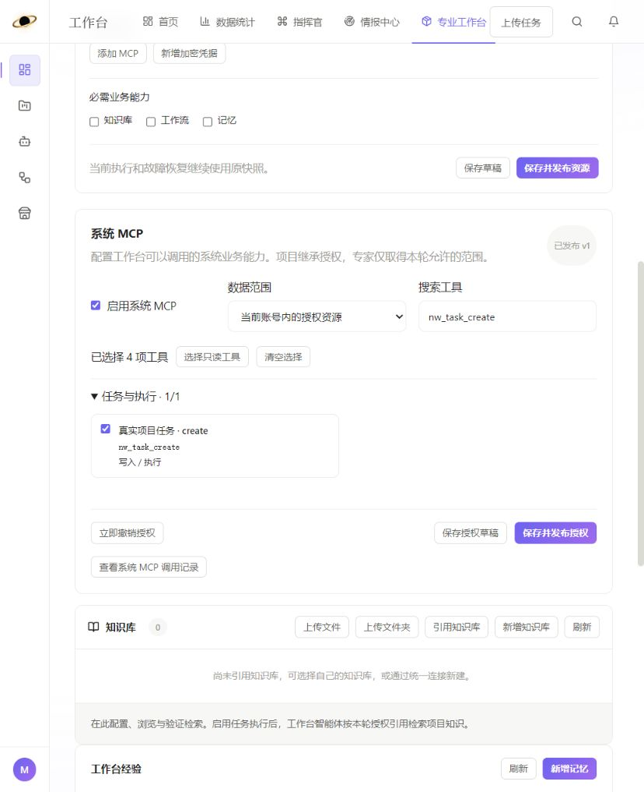
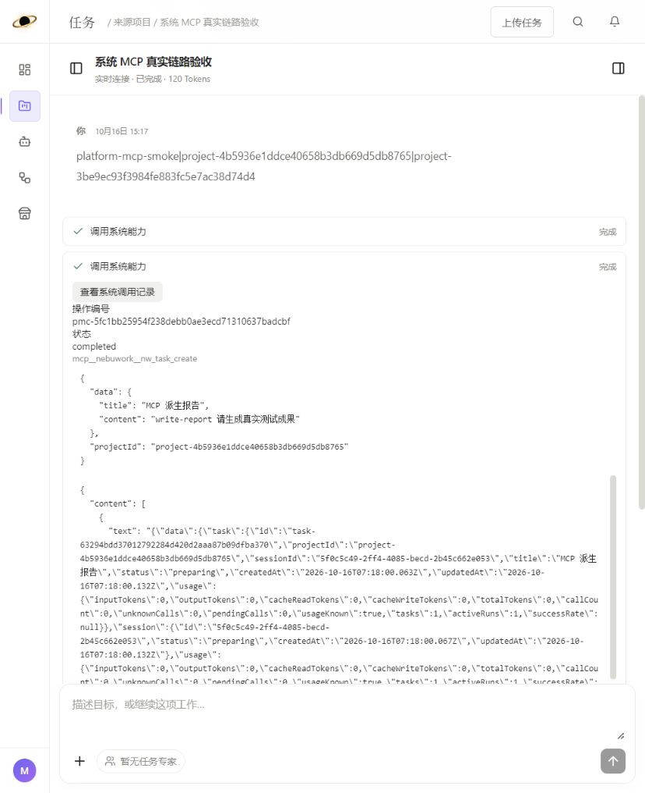

# 系统 MCP 交付与运行说明

本次在三个现有仓库实现内部系统 MCP：Java 负责真实业务、账号与资源授权，NebuAgentCoreNew2 提供独立协议进程和 Worker 适配，NebuWorkAgent 提供工作台授权与调用记录界面。指挥官和情报中心页面没有在本次扩展。

## 实现范围

Java 唯一注册表维护 172 个 `nw_` 工具；完整清单、参数及恢复语义见 [工具目录](platform-mcp-tools.md) 和 [机器可读 Schema](platform-mcp-catalog.json)。所有清单工具有显式业务适配，不提供任意 SQL、任意接口代理或浏览器 Cookie 回调。已有连接、模型密钥、系统策略、会话授权创建和记忆审核仍由人工入口维护。


- 默认关闭。启用时默认当前项目只读；工作台策略独立于运行资源保存和业务发布。
- 新轮次冻结授权版本；每次调用执行冻结与当前授权的交集。扩大只影响新轮次；撤销立即生效，重新发布不会恢复被撤销轮次。
- 运行凭证为十分钟有效的不透明随机值，Java 仅保存哈希，Worker 按需续期。凭证保存在客户端闭包，不写入模型上下文、事件、成果或检查点。
- Java 从引擎核实真实 Run、账号、项目、会话、快照哈希与状态。专家不能取得账号级创建权限或读取其他专家的会话/记忆。
- 本地变更与成功台账同事务；远端操作保存原编号。回执恢复不会自动重复创建未知的任务、工作流或知识库。
- 任务创建和跨任务发起执行记录来源 Run 与目标任务；派生任务和专家被阻止再次进行业务任务调度。
- 文件输入使用固定成果版本或受控资源；运行文件保留相对路径和完整 Skills。FAQ 文件支持现有 JSON/CSV 格式。文件输出有账号、Run、来源授权与固定版本检查。
- Agent 新记忆、提升/修改建议和草稿编辑保留真实来源与待审核状态。审批发布接口没有暴露给模型。
- 未启用及历史轮次保留原业务工具；启用轮次隐藏重复知识/记忆/Workflow 工具。原生工作区与专家协作、第三方 MCP 保留。

## 修改位置

| 仓库 | 主要文件 |
|---|---|
| Java `content-cloud-cluster-service/nebuwork-backend-api` | `platformmcp/PlatformMcpCatalog`、`PlatformMcpSchemas`、`PlatformMcpService`、`PlatformMcpDispatch`、公开/内部 Controller、FAQ 文件适配；`V22__platform_mcp.sql` |
| Java 现有业务 | `AgentBridge` 固定快照/授权；`RuntimeResources` 保留系统标识；`KnowledgeService/KnowledgeEvidence` 当前知识 ACL 与稳定证据；`MemoryService` Agent 草稿接口 |
| `NebuAgentCoreNew2` | `platform-mcp-server.ts`、`platform-mcp-client.ts`、`platform-mcp-main.ts`；运行快照、工具恢复、会话授权查询、原请求查询、部署 profile |
| `NebuWorkAgent` | 运行资源下的 `PlatformMcpEditor`；Settings 的系统 MCP 目录/调用记录；任务卡的调用记录入口和系统 MCP 快照展示 |

## 配置与上线

先按正常目标环境流程备份并部署 Java，执行新增 V22 迁移。新增四张表：`nw_platform_mcp_policy/grant/call/resource`。历史发布、运行快照及已有业务数据不迁移、不自动启用。`revoked_before_revision` 用于阻止旧运行在策略重新发布后恢复权限。

Java 部署配置（由环境管理，不能由工具修改）：

```yaml
nebu:
  platform-mcp:
    url: http://<worker可达的内部MCP地址>:42120/mcp
    service-key: <独立且至少32字符的服务凭据>
```

引擎仓库 `npm run build` 产出独立入口 `dist/platform-mcp-main.js`。服务只需要：

```text
BUSINESS_API_URL=http://<Java内部地址>:42020/nwaa
PLATFORM_MCP_SERVICE_KEY=<与Java一致的独立服务凭据>
PLATFORM_MCP_HOST=0.0.0.0
PLATFORM_MCP_PORT=42120
```

`deploy/compose.yml` 新增 `platform-mcp` profile，使用现有引擎镜像。该进程没有数据库、S3 凭据或 Docker socket 挂载。默认端口只映射到宿主机回环地址；跨主机部署通过现有内部网络提供 Worker 可达地址。协议固定 `2025-11-25`，SDK 固定 `1.32.1`。`GET /health/live` 只表示进程存活，不代表业务依赖健康。

上线顺序：Java/表结构 → 独立 MCP 服务 → 新 Worker → 前端 → 手动启用指定测试工作台。工作台配置中的“系统 MCP”区域支持草稿、发布、即时撤销；Settings → 系统 MCP 展示工具目录和本人记录，任务工具卡可查询原操作编号。回退通过撤销策略阻止调用；保留调用记录和已创建的真实任务。

公开 API 使用既有账号认证；内部 Agent 回调使用既有认证；MCP→Java 接口另查独立服务凭据与有效运行凭证。不能只配置其中一个凭据。没有提供外部 MCP 客户端、OAuth 客户端管理或客户端注册。

## 接口入口

| 接口 | 用途 |
|---|---|
| GET /api/platform-mcp/catalog | 当前已实现的唯一工具目录 |
| GET/POST /api/workbenches/{id}/platform-mcp-policy | 授权草稿，按 revision 检查；写请求支持 Idempotency-Key |
| POST .../platform-mcp-policy/publish、revoke | 发布给新轮次，或即时撤销 |
| GET /api/platform-mcp/operations、/{id} | 本人调用元数据和持久化编号，分页查询 |
| POST /internal/agent/platform-mcp/grants | 核实真实 Run 后签发短期凭证 |
| POST /internal/agent/platform-mcp/authorize、reconcile | Worker 的重放授权和原回执核对 |
| POST /internal/platform-mcp/context、execute、reconcile、resources/read | 独立服务凭据与运行凭证同时验证 |
| MCP POST /mcp | 初始化、工具发现/调用、受控资源读取 |

## 验证证据与验收状态

- Java 全量回归 403 项，4 项按环境开关跳过，无失败；末轮 MCP 专项 201 项通过，包含受控文件版本验证。MCP 专项包含 172 个逐工具适配测试、嵌套参数校验、账号隔离、授权交集、撤销/重新发布、稳定调用去重、来源记忆草稿、FAQ 多行 CSV，以及丢失响应后读取原任务回执。
- 引擎官方 SDK 的真实 Streamable HTTP 测试通过，包括初始化、目录、调用、输入/输出校验、引擎调用编号透传、撤权和凭据隔离；现有引擎、原生工具与恢复测试通过。
- 前端 313 项测试、类型检查、构建与 4 项 Sites 包装检查通过；引擎 26 项测试通过。浏览器核对了真实目录、已发布授权、工具搜索、调用记录和任务卡操作编号。
- 隔离链路验收使用独立 H2、测试 MySQL/Redis/MinIO 和脚本化 HTTP 模型，实际经过 Java → Worker → MCP → Java，完成项目查询、跨工作台任务创建、真实 S3 成果和待审核记忆。此项证明执行/协议/业务链路，**不能替代真实已保存模型及知识/Workflow 上游的全场景验收**。
- 目标环境尚未部署；最终真实模型验收需要指定隔离账号、测试项目、已保存模型和已配置的知识/Workflow 测试资源。不能把适配测试通过视为所有上游真实写入都已验证。

隔离验收入口：Java `PlatformMcpAcceptanceHostTest`（显式环境开关），引擎 `tests/platform-mcp-acceptance.ts`。使用固定测试端口 42023、42220/42221/42222；不会连接生产业务库。完成标志路径通过 `nebu.acceptance.done` / `PLATFORM_ACCEPTANCE_DONE` 指定，必须为每次运行选择新路径。`PLATFORM_ACCEPTANCE_KEEP=1` 可保持测试网关用于浏览器核对。

配置与调用记录验证图：





## 本次保留的业务边界

工作台/专家跨项目汇总用量和账号级新建资源采用主执行账号范围授权；当前项目范围只返回本项目及固定资源。专家共享定义的修改不会转成账号私有修改。其他任务正文依赖现有会话授权；查询元数据不会自动授权正文。

受控资源默认一天过期，必须在有效 Run 与当前授权下读取；稳定证据继续按原知识访问规则检查。知识原文件/导出资源在签发时固定内容哈希；上游内容变化会明确报版本冲突，不能悄悄读取新版本。大文件保留原大小限制，文本/二进制分段都有 `nextOffset`，不会静默返回一段当作完整文件。上游故障、旧驱动不支持和计量未知保留明确状态。

暂缺的情报采集/评分/地图、指挥官账号会话、项目 SQL 浏览/定时任务、IM、桌面执行体、成员权限等没有占位工具。原管理页面继续负责连接测试、技术模板配置、密钥轮换、知识分配与人工审核。

本轮集成检查还修正了工作区新增 `workbenchservice/ServiceOperations` 的两处异常状态访问和工具 JSON 返回类型，使其与 Java 8 及现有 ApiException 接口兼容；该服务的业务流程不属于本次 MCP 验收范围。
