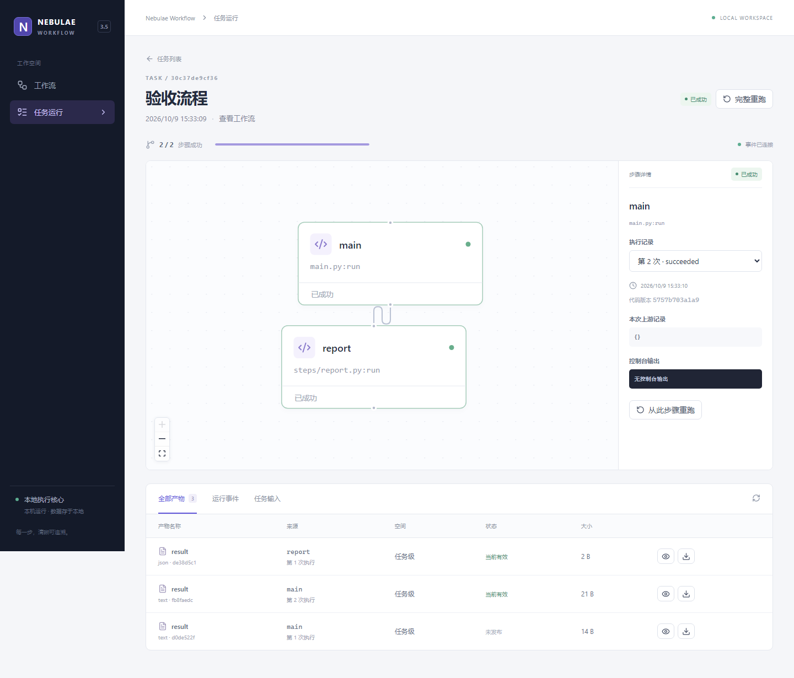

# v3.5 实施与验收记录

验收日期：2026-10-10（环境管理增量；原执行核心于 2026-10-09 交付）。所有实现文件位于 `nebulae-ai-platform-v3.5`；未修改原 V3 项目，未加入 NebuWork 的会话、智能体或用户体系。

## Pi 工作流助手增量验收（2026-10-12）

内置助手使用锁定的官方 `@earendil-works/pi-coding-agent@1.1.0`，由 Python 按需启动 Node 子进程。MCP 和助手共用工具目录与 Workflow HTTP 接口，保留原 MCP 的 28 个工具及行为；助手额外提供可中断等待、长结果分页和服务端工作流归属校验。页面包含 AI 创建、独立会话历史、流式消息、工具记录、源码差异及全局模型设置。

| 验证 | 实际结果 |
|---|---|
| Windows Python 完整回归 | **73 passed**（229.21 秒） |
| Linux Python 完整回归，Docker 只读挂载、临时数据 | **73 passed**（93.29 秒） |
| Chromium + Windows 服务端完整页面回归 | **13 passed**（59.4 秒） |
| TypeScript 检查及 Vite 正式构建 | 通过 |
| wheel 独立安装、静态资源、Pi SDK 载荷、专属环境步骤及产物 | 通过 |
| 当前项目的可选 Pi 运行依赖安装 | 通过；Node 22.19.0，Pi 1.1.0 |

新增 Python 场景实际加载 Pi SDK，使用本地模拟模型接口验证 Chat Completions 和 Responses 的流式输出与工具调用，覆盖：串行/并行/汇合构建、执行失败后读取错误并修复和预览重跑、显式产物、离线依赖安装、跨工作流拒绝、版本冲突、配置脱敏、命令去重、长结果分页、上下文压缩、50 次工具限制、停止助手不取消任务、父进程异常退出后的子进程清理，以及重启后仅人工继续。SQLite v2→v3 迁移在备份后保留原任务与产物。

页面实际完成模型连接测试 → AI 创建 → 自动编辑/校验/执行/修复/重跑 → 打开修改差异 → 刷新恢复历史，并验证未保存的图编辑草稿保留、桌面与窄屏独立滚动。特设网络故障场景：服务端已接受首条消息但响应丢失，再次发送使用原命令和版本，仍只有一轮执行。原 MCP 启停、环境、产物目录、流程修复与源码冲突页面测试同时通过。

测试均使用独立运行目录和本地模拟模型，没有配置或调用真实付费模型。本次没有重启用户正在运行的服务，也没有打开真实运行数据库迁移；服务下次启动时执行增量迁移。真实模型的连接和完整构建仍须在用户填写服务配置后验证。Linux 记录覆盖后端及助手生命周期；本次新增助手浏览器场景运行于 Windows，不宣称远端 CI 已执行。

使用说明：[AGENT.md](AGENT.md)。界面证据：[模型设置](ui/agent-settings.png)、[工作流与助手并排](ui/agent-workbench.png)、[窄屏助手](ui/agent-mobile.png)。下文保留先前各阶段的历史验收记录。

### 助手工具记录展示调整（2026-10-12）

工具调用改为紧凑的执行记录，继续使用 Ant Design Collapse、Tabs、Tooltip 和 Button。中文动作与文件名替代默认英文工具名；完成、执行中、失败、待核对分别显示。连续调用合并为一组，默认展示最近四项，可展开全部历史；真实的助手说明、用户消息及不同轮次保持顺序和分组。失败或待核对数量始终可见。展开单项后可查看原始工具名、参数、返回结果、任务链接和代码差异；长路径悬停显示完整内容，长结果独立滚动。

TypeScript/Vite 正式构建通过，完整 Chromium 页面回归 **14 passed**。新增展示场景覆盖 20 次调用、失败及未知状态、真实文本分隔、空模型消息合并、长文件名、键盘展开、详情与聊天独立滚动、390px 窄屏及固定输入区。真实 Pi 构建/修复/重跑测试继续验证完整历史、参数与结果页签、Monaco 差异以及刷新后的会话恢复。此次仅调整页面展示和查询时机，任务执行与存储语义保持不变。

界面证据：[紧凑执行记录](ui/agent-tools-compact.png)、[窄屏执行记录](ui/agent-tools-compact-mobile.png)。

## 运行事件中文展示（2026-10-12）

运行事件采用 Ant Design 组件展示中文时间线。顶部依据当前任务状态说明异常步骤及受影响下游；每条事件解释发生了什么，并保留对应步骤和执行次数的跳转。超时、阻塞、重试、重启中断、产物暂存、环境绑定及自定义日志/进度均有可读说明。原始错误、完整输出和事件 JSON 保留在可展开的技术详情中。提供异常/日志筛选、步骤筛选与搜索，长详情独立滚动，适配窄屏。

TypeScript/Vite 正式构建通过，完整 Chromium 页面回归 **16 passed**。新增两个浏览器场景：使用真实步骤复现超时、阻塞下游及任务失败，修复后重跑成功，验证当前状态与旧失败记录区别、历史 Attempt 定位、筛选和 390px 布局；另覆盖缺少模块、自动重试、中断后人工处理、混合控制台输出、长日志独立滚动、自定义载荷及未知事件的保留。仅已知的纯调试器提示被解释为调试信息，混合业务输出不会被覆盖；不通过日志内容判断任务成功或失败。

测试运行于独立临时目录，未修改真实工作流或任务。助手回归中的页签检查使用键盘激活，避免展开动画期间鼠标落点变化影响断言。任务调度、事件协议及存储均未调整。界面证据：[中文运行事件](ui/events-readable.png)、[窄屏筛选与解释](ui/events-mobile.png)。

## MCP 增量验收（2026-10-12）

新增 28 个 MCP 工具、`workflow://guide` 资源、stdio 与本机 Streamable HTTP 两种接入方式、PyCharm `start_mcp.py` 启动入口和智能体 JSON 配置示例。接口复用运行中的 Workflow API，原数据库 schema 不变。

| 验证 | 结果 |
|---|---|
| Windows Python 3.12.12 全部既有测试及首批 8 个 MCP 场景 | 51 passed（其中既有测试 43 项） |
| Linux Python 3.12.11 全部既有测试及首批 8 个 MCP 场景 | 51 passed |
| Windows 最终完整 MCP 测试集（追加启动目录、离线安装场景后） | 10 passed |
| Linux 从 wheel 安装后，在源码目录外运行最终完整 MCP 测试集 | 10 passed |
| uv 锁文件一致性、wheel/sdist 构建、diff 空白检查 | 通过 |

最终覆盖既有 43 项及新增 10 项测试。实际协议客户端分别经 stdio 子进程和 Streamable HTTP 完成：新建工作流 → 保存两个步骤与 DAG → 创建/执行任务 → 失败日志与暂存产物 → 修复代码 → 预览并重跑下游 → 检查复用的上游 Attempt 和新旧产物。

另覆盖发现工具/资源、必填版本校验、源码冲突和历史恢复、复制/归档、越界路径、重复任务及环境命令、过期环境令牌整体拒绝、游标续读、连接错误、旧协议协商、Host/Origin 拒绝、从任意工作目录启动脚本、创建专属环境并通过 requirements 安装离线 wheel 后运行任务。连接 MCP 不构造调度器、不自动执行排队任务或环境操作。

Linux wheel 验证使用只读挂载源码和临时容器；测试均使用临时工作流/运行目录。临时容器已退出。MCP 首轮只验证协议，随后新增管理页面的验收见下一节；其他历史页面记录保留原验收日期。接入方式见 [MCP.md](MCP.md)。

### MCP 管理页面补充（2026-10-12）

侧栏新增「MCP 接入」，沿用 Ant Design 和灰白工作台样式。支持查看依赖状态、生成 HTTP/stdio 配置、复制命令和配置、限时检测真实本机 MCP 连接、搜索 28 个工具、展开参数和开发指南。依赖已安装与 MCP 已连接分别展示，参数调整不会冒充服务已重启。

- TypeScript 检查与 Vite 正式构建通过，静态资源已更新。
- `tests/test_mcp.py` **12 passed**：新增管理信息/缺失依赖、真实 MCP 初始化探测、端口与 Origin 校验；读取和检测不创建调度器或任务。
- `tests/test_api.py` **8 passed**，原有 API 行为回归通过。
- Chromium 全部页面测试 **5 passed**：新增配置复制/方式切换/端口变化/工具搜索/参数展开/窄屏无横向溢出，以及旧服务明确提示 PyCharm 重启；原流程编辑、运行修复重跑与独立环境场景同时通过。

页面截图：[HTTP 接入](ui/mcp-http.png)、[stdio 配置和工具参数](ui/mcp-stdio.png)。首次页面交付仅生成连接参数；下述启停补充已增加配置持久化。未自动改写智能体配置或重启真实服务。

### MCP 页面启停补充（2026-10-12）

HTTP 模式新增保存配置、启动和停止按钮，以及真实运行状态、PID、失败原因和启动日志。端口保存在运行目录，服务重启后 MCP 默认停止；页面管理的子进程随 Workflow 服务关闭，独立 CLI/stdio 实例仍由原启动方管理。

- Windows Python 3.12：完整后端测试 **62 passed**，包含新增 `tests/test_mcp_service.py` 的 7 个生命周期场景。
- Linux Python 3.12：临时容器安装当前 wheel，新增生命周期测试 **7 passed**。
- Chromium：全部页面测试 **6 passed**；新增「保存端口 → 刷新保留 → 启动真实 MCP → 检测成功 → 查看日志 → 停止 → 检测失败」场景，未产生业务任务，浏览器无异常。
- TypeScript / Vite 构建、wheel/sdist 构建通过。

后端使用真实受管理进程验证：协议可连接并能查询 API、重复命令不重复启停、过期版本拒绝、运行中禁止修改端口、占用端口不会误认或终止外部服务、子进程崩溃可见、父进程被强制结束后进程树退出、重启不重放启动命令、配置写失败不错误确认、损坏配置可重新保存修复，以及停止 MCP 后已提交工作流仍成功完成。

界面证据：[页面管理的 MCP 运行状态](ui/mcp-running.png)。验收全部使用临时运行目录；没有启停用户的实际 Workflow 服务或任务。

### 产物列表与目录树（2026-10-12）

任务「全部产物」和工作流「共享产物」共用 Ant Design 产物浏览器。列表显示完整名称；目录树按产物名称分组，支持逐级打开文件夹、双击进入、树节点定位、面包屑和返回上一级。记住展示方式，任务状态刷新保留所在目录。没有迁移或改写业务产物、源工作流或数据库。

- TypeScript 检查及 Vite 正式构建通过。
- Chromium 完整页面回归 **9 passed**，包括原流程修复重跑、Python 环境及 MCP 启停场景。
- 新增 `frontend/tests/artifacts.spec.ts` 的 3 个真实 API/浏览器场景：多层中文目录；列表/树切换；跨目录分页重置；同名文件与目录共存；不同任务、空间、成功历史和未发布版本不合并；JSON/文本预览与原始文件下载；刷新、空目录和窄屏显示。
- 测试使用临时项目，测试服务默认端口改为 18765，可通过 `NEBULAE_E2E_PORT` 调整，避免与默认 MCP 端口冲突。

界面证据：[目录树与逐级浏览](ui/artifacts-tree.png)、[完整名称列表](ui/artifacts-list.png)。

### 产物滚动与展示修复（2026-10-12）

使用 99 个长文件名和 80 个根目录产物复现：旧表格高度达到 1616px，分页落到视口以外；树滚动后再通过表格进入目录，当前节点未被定位。修复后浏览器根据窗口可用高度分配左右区域，目录树与文件区分别滚动；表头、分页和右侧操作列固定，长文件名与来源省略显示并保留完整悬停提示。窄屏下目录区只有一层滚动，切换目录定位树节点，翻页重置列表滚动位置。

`frontend/tests/artifacts-layout.spec.ts` 覆盖原生滚动条显示与鼠标拖动、左右滚动独立、表头/分页位置稳定、树节点定位，以及 1440×900、1024×768、800×1100、390×844 窗口的布局和操作可达性。Playwright 已取消 Chromium 默认隐藏滚动条的启动参数，截图和测试包含真实滚动条。完整 Chromium 页面回归 **10 passed**，TypeScript/Vite 构建通过。

界面证据：[大量产物与滚动条](ui/artifacts-scroll.png)、[窄屏布局](ui/artifacts-scroll-mobile.png)。

## 阶段交付

| 阶段 | 交付结果 |
|---|---|
| P0 统一契约 | 文档与示例统一使用显式产物接口；返回值不持久化；重启默认人工恢复 |
| P1 状态与存储 | SQLite schema v1、两级产物空间、暂存/发布、Attempt 来源和历史 |
| P2 执行内核 | DAG 校验、并发子进程、代码快照、暂停/取消、超时/重试、进程树清理 |
| P3 恢复与重跑 | 下游闭包失效、上游 Attempt 固定、重跑预览、启动后人工授权 |
| P4 API 与页面 | Python/CLI/HTTP v1/SSE、React Flow 编排、Monaco 编辑/差异/恢复、任务详情 |
| P5 验收与交付 | 自动化测试、跨平台验证、示例、依赖锁文件、带静态页面的安装包、开发与备份文档 |

## 实际运行结果

| 检查 | 结果 |
|---|---|
| Windows Python 3.12.12 后端测试 | **43 passed** |
| Linux Python 3.12.11 后端测试（Docker 隔离环境） | **43 passed** |
| Chromium + Windows 服务端页面端到端测试 | **3 passed** |
| Chromium + Linux 服务端页面端到端测试 | **3 passed** |
| TypeScript 检查与 Vite 正式构建 | 通过 |
| npm 生产依赖审计（2026-10-09，依赖未变） | 0 vulnerabilities |
| wheel 构建、独立安装、专属环境 SDK 隔离、产物、UTF-8 日志、静态资源检查 | 通过 |
| 本机页面运行内置 demo（2026-10-09） | 4/4 步骤成功；任务产物与工作流共享产物均可查看 |

浏览器验收使用 Windows Chromium 156；Linux 部分使用 Linux 服务端和相同浏览器。仓库中的 CI 配置另外定义了 Windows、Ubuntu 各自的核心与浏览器验证矩阵；此记录不宣称远端 CI 已运行。

测试过程出现 FastAPI/Starlette TestClient 对 httpx 的弃用提示，不影响测试结果；运行服务不使用 TestClient。生产核心没有 Redis、MySQL、Celery、Docker 或 Node 服务依赖。Docker 仅用于本次 Linux 验收。

## 场景覆盖

本次环境管理新增 `tests/test_environments.py`，使用标准 venv、离线 wheel 和真实子进程，覆盖：

- 旧流程默认共享；包列表不依赖 pip；不同工作流安装同一包的不同版本，独立环境看不到共享包。
- 执行轮次固定环境，自动重试不切换；人工恢复/重跑重新绑定，Attempt 保留旧环境版本。
- 排队、运行、等待重试和暂停收尾占用环境；暂停完成后允许安装；安装期间任务不得启动。
- requirements 内容和源码资源快照；重复命令去重、过期版本拒绝、依赖冲突、失败后修复。
- 缺失解释器不使结果失效；创建失败、重建保留旧目录、复制工作流不复制环境。
- 队列/执行中环境操作重启后均不自动继续；安装进程超时、服务强制退出后整个进程树停止。
- schema 1→2 迁移备份、旧 Attempt 环境为空；中文及 emoji 日志的跨块游标续读。
- 模拟正式 site-packages 安装位置，验证 SDK 引导不会把服务环境其他包暴露给独立步骤。

`tests/test_api.py` 同时覆盖新增 API、任务预检、Python Client 重试和 CLI。`tests/smoke_wheel.py` 在临时服务虚拟环境中实际安装 wheel，再创建独立环境运行步骤，检查打包静态资源、SDK 隔离、显式产物及中文日志。

`frontend/tests/environments.spec.ts` 在 Windows、Linux 服务端各完成：查看共享包与搜索刷新 → 创建专属环境 → 安装离线 requirements → 保存环境选择 → 运行 → 检查任务/Attempt 的实际环境 → 检查重跑预览。所有三个浏览器场景均断言无页面异常。

界面证据：[共享包列表](ui/shared-environment.png)、[工作流环境管理](ui/workflow-environment.png)、[任务环境记录](ui/task-environment.png)。界面继续使用 Ant Design，灰白工作台风格；仅新增业务页面，没有另建调度逻辑。

`tests/test_core.py` 覆盖：

- 串行、并行和汇合；循环、自依赖、无效入口、越界入口拒绝执行。
- 变量与任意返回值不自动保存；同步/异步无产物步骤允许成功。
- JSON、文本、文件的显式保存；任务隔离和跨任务共享、跨工作流隔离。
- `A → B → C，D → C` 从 B 重跑；B 新失败时 C 阻塞；恢复后固定新 B 与原 D。
- 缺少产物不回退旧成功记录；未声明依赖不能读取。
- 同一任务未执行步骤热加载，辅助模块相同 mtime 修改也生效；代码快照保留。
- 创建时 DAG 固定；后续编辑只影响新任务。
- 暂停收尾、继续、重试、超时、命令去重、版本冲突。
- 排队、运行、等待重试任务重启后不执行；查询不会恢复；调度器互斥。
- 源码外部修改冲突、版本恢复、损坏 JSON 可修复、日志尾部保留。

`tests/test_processes.py` 使用真实子进程验证取消、超时、步骤进程崩溃和调度器被强制终止时，关联进程树停止；失败暂存产物未发布，重启后只有人工恢复才执行。

`tests/test_api.py` 覆盖源码管理、CRLF 规范化、草稿校验不保存、产物下载、SSE 游标续读、创建/控制去重、Python 客户端重试、标量输入、本地 Origin/路径限制和真实服务生命周期恢复。

`frontend/tests/workflow.spec.ts` 覆盖两个实际浏览器场景：

1. 创建工作流 → 添加节点和依赖 → 编辑 Python → 保存并运行 → 查看错误及未发布产物 → 修改代码 → 查看版本差异 → 预览下游重跑范围 → 双击提交 → 成功 → 查看新旧产物 → 刷新后恢复事件连接和状态。全过程断言无浏览器异常。
2. 页面保持旧版本时从另一客户端修改源码；再次保存时显示冲突，确认外部版本未被覆盖。文件系统外部直接修改另由核心测试覆盖。

## 数据与交付约定

- 正式数据默认写入 `.runtime/v1`，旧原型 `.runtime/state.sqlite3` 与原目录保留，没有迁移或自动清理。
- 正式 schema 1 增量升级到 2 前自动备份；现有真实运行库未被验收测试打开或改写。环境及旧 generation 目录保留，重启不自动创建、安装或执行。
- 独立安装包位于 `dist/nebulae_workflow-1.0.0-py3-none-any.whl`；产品版本为 v3.5，Python 包发布版本为 1.0.0。
- 历史记录不自动清理；暂停让当前执行收尾，进程强制中止不回滚业务代码已产生的外部副作用。
- 本机单人模式；跨机器调度、恶意代码沙箱、账号权限平台、业务迁移和 NebuWork 接入均在本阶段范围之外。
- 当前任务列表展示最近 100 条，API 最多查询 1000 条；数据库历史完整保留。
- 源码保存采用版本检查和原子替换；与任意外部编辑器同时写入的极短竞争窗口详见架构文档。

复现命令、启动方式和停机备份流程见项目 README。
