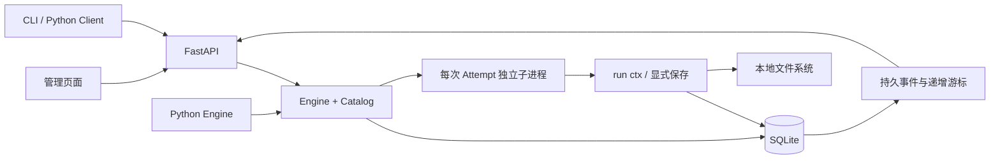

# 架构与稳定契约

## 模块边界

| 模块 | 职责 |
|---|---|
| `definition.py` | DAG、入口、参数校验；计算下游闭包；源码快照 |
| `store.py` | SQLite 事务、表结构、事件和并发写入 |
| `context.py` | 步骤上下文、显式产物保存与依赖读取 |
| `process.py` / `_worker.py` | 调度器互斥、进程树生命周期、同步/异步入口 |
| `engine.py` | 状态转换、派发、暂停、取消、重试、恢复和重跑 |
| `catalog.py` | 工作流管理、源码编辑、冲突校验、版本历史 |
| `environments.py` / `_environment_worker.py` | 环境配置、包清单、事务占用、后台 venv/pip 操作与执行版本绑定 |
| `api.py` / `client.py` / `__main__.py` | HTTP、Python HTTP 客户端、CLI 适配 |
| `frontend/` | React Flow + Monaco 管理页面，仅调用上述管理接口 |

核心包只使用 Python 标准库。HTTP 作为可选依赖安装；管理页面构建为包内静态文件。

## 实体与状态

- Workflow：源码目录、JSON 流程、归档标志与源码修订记录。
- Task：一次完整运行；保存输入、创建时固定的 DAG、状态、版本和人工授权的调度会话标记。
- Step：Task 中某个节点的当前状态、累计执行次数和有效成功 Attempt 引用。
- Attempt：一次实际执行；记录状态、时间、错误、代码快照、哈希、进程 ID 和固定的上游引用。
- Artifact：命名产物元信息、文件路径和哈希、所属任务/工作流/步骤/Attempt、发布顺序。
- Event：不可变事件记录，整数 ID 单调递增；跨任务共用序列，因此单个任务的 ID 不要求连续。
- Command：命令 ID、请求指纹与目标 Task，用于重复请求去重。

Task 主路径：`ready → queued → running → succeeded / failed`。

| 操作/情形 | 语义 |
|---|---|
| start | 仅 ready 可开始；获得本调度会话执行资格 |
| pause | queued/running 停止派发，已有步骤收尾；pausing → paused，若全部结束则进入最终状态 |
| cancel | 未完成节点取消；运行节点先进入 cancelling，进程树停止后 cancelled |
| resume | paused/failed/cancelled/waiting_manual；保留有效成功引用，未完成节点回到 pending |
| rerun | 任务停止后才允许；指定节点的下游闭包失效并重新排队，不指定节点表示全部 |
| 进程重启 | 未完成任务全部 waiting_manual，旧 running Attempt 全部 interrupted |

Step 状态包括 pending、running、retry_wait、succeeded、failed、blocked、cancelled、interrupted。Attempt 最终状态额外区分 timed_out。自动重试以每次人工启动/恢复/重跑开始的执行轮次计算，`retries` 表示首次失败之外额外允许的次数；累计 Attempt 编号永不回退。

启动调度器需要持有运行目录的 OS 文件锁。每次启动生成新的会话标记，只有本会话中人工授权的任务能被派发；排队记录本身不等于授权。查询不会启动调度或更改任务恢复状态。

## 依赖、重跑与发布

派发前在数据库事务中确认依赖成功并固定直接上游 Attempt。读取 `ctx.task.read(step, name)` 必须匹配此引用；不从目录、日志、返回值或更旧成功记录推断结果。

`A → B → C，D → C` 从 B 重跑时：B、C 的有效成功引用置空，历史仍存在；A、D 保留。本轮 C 只有在新 B 成功后才能启动。旧 C 和旧 B 的任务产物均标为历史，B 新执行失败时无法绕过它读取旧值。

产物文件先写临时文件，flush/fsync 后原子替换，再登记暂存元信息。Attempt 成功提交时，产物发布标记和成功状态在同一数据库事务完成；失败、中断、取消不发布。写入过程中崩溃可能留下未引用文件，第一版不自动清理。

同一 Attempt、同一空间内重复保存同名产物，以最后一次保存为准。跨 Attempt 不覆盖历史。共享产物按成功事务提交顺序发布；读取最新已发布版本，跨任务隔离按 Workflow ID 实现。任务重跑失效的是任务结果引用，已经发布的工作流共享版本保留，直到后续成功提交更新；共享空间不是任务结果的隐式替代来源。

## 热加载与进程生命周期

每次启动步骤均复制工作流目录中的源码/资源，排除缓存、虚拟环境和运行目录，拒绝符号链接/目录联接；保存 SHA-256，再启动全新 Python 解释器。辅助模块从这份快照导入，禁用字节码缓存。因此同一秒内、相同文件大小的修改也能生效。

Windows 使用 Job Object，父进程退出即关闭 Job 并终止成员进程；POSIX 使用独立进程组，子进程监视父进程管道关闭。取消、超时、正常结束和异常结束均清理关联子进程。任意 Python 代码本身不是受限沙箱，主动逃离进程组/启动系统服务不属于支持用法。

步骤正常返回只产生执行完成信号，返回值不序列化。调度器根据进程退出状态和内部完成协议决定提交成功，SQLite 记录是对外状态的唯一依据。

## HTTP v1

### Python 环境协议

Workflow 可选 `environment.mode = shared | isolated`，默认共享。此配置在每次人工执行命令时读取当前源码，和任务创建时冻结的 DAG 分离。Task 保存当前执行轮次的 `environment_revision`，Attempt 固定复制该引用；`environment_revisions` 不可变，记录模式、解释器绝对路径、Python 版本、generation 和包清单。旧记录的环境为 null。

`environments` 维护每个工作流的当前专属环境、状态、版本号。状态为 not_created（无记录）、creating、installing、rebuilding、ready、needs_repair。`environment_operations` 保存独立的命令 ID、请求指纹、epoch、依赖文件快照和操作前后包清单；命令状态 queued → running → succeeded/failed，重启时 queued/running → interrupted。每次操作只处理一个进程树，其他环境的任务仍可并行执行。

任务绑定与环境操作预订均在 `BEGIN IMMEDIATE` 中检查：独立环境 ready 方可绑定；同一环境没有 queued/running/pausing/cancelling 任务方可修改，等待重试的 Task 仍为 running。配置切换不释放正在运行任务的环境占用。没有隐式创建、隐式安装或失败后回退共享环境。查询不会调度操作。

环境包列表通过目标解释器的标准库读取，不导入业务模块。独立环境查询及步骤启动采用隔离搜索路径；`_bootstrap.py` 仅加载 SDK 包自身的模块目录，不能把其父级（安装后通常为服务的 site-packages）加入 sys.path。移除继承的 PYTHONPATH/PYTHONHOME 并禁用用户 site-packages。创建使用服务 Python 的标准 venv，安装通过目标解释器的 pip 执行，安装后运行 pip check 并验证 SDK 可导入。环境操作同样受 Job Object/进程组及父进程管道管理，30 分钟超时。

| 方法与路径（均带 /api/v1） | 请求与响应 |
|---|---|
| GET /environment/shared | 服务解释器、Python 版本、包名/版本列表及 observed_at |
| GET /workflows/{id}/environment | mode、workflow_revision、version、state、current、occupants、操作历史 |
| PUT /workflows/{id}/environment | mode + expected_revision；只更新环境字段，源码版本检查 |
| GET /workflows/{id}/environment/packages | 专属环境当前实测包清单；修改期间返回 409 |
| POST /workflows/{id}/environment/operations | kind(create/install/rebuild)、expected_version、command_id；install 另传 packages 数组或 requirements=true；202 返回操作记录 |
| GET /environment/operations/{id}?after=0 | 操作详情、log、cursor、has_more；游标为日志字节偏移，保证 UTF-8 字符完整 |

重跑预览新增 `environment` 与 `environment_token`，控制命令可传 `expected_environment` 防止预览后环境变化。页面提交该令牌。环境不可用时事务回滚，旧步骤和产物引用不失效。共享环境不能由这些接口安装包；独立环境在框架外改包后需重新通过安装校验才能绑定。

环境安装与源码文件快照放在 `.runtime/v1/environments`，不放进工作流源码目录；复制、归档不克隆或删除环境。schema 1→2 升级需持有调度器 OS 锁并先做 SQLite backup；旧任务、Attempt、产物保留，旧环境信息不推测补齐。

### 任务与源码协议

固定前缀 `/api/v1`；请求体为 JSON；校验错误 422、状态/版本冲突 409、缺少文件 404。具体响应模型以本地 `/docs`、`/openapi.json` 为准。

| 方法与路径 | 用途 |
|---|---|
| GET /health | 服务与调度器状态 |
| GET/POST /workflows | 列表/创建；创建含 id、name、可选 copy_from |
| GET /workflows/{id} | 定义、源码列表、revision、校验错误、归档状态 |
| PUT /workflows/{id}/definition | definition + expected_revision 保存 |
| POST /workflows/{id}/validate | 空请求校验已保存定义；definition 请求体校验草稿，不保存 |
| POST /workflows/{id}/archive | archived 布尔值 |
| GET/PUT /workflows/{id}/source?path=... | 读取/保存文本；保存含 content、expected_revision，新文件 revision 为 null |
| GET /workflows/{id}/revisions?path=... | 源码版本内容和摘要 |
| POST /workflows/{id}/restore?path=... | revision_id + expected_revision；恢复形成新版本 |
| GET /workflows/{id}/artifacts | 关联产物，含 scope/published/effective |
| GET/POST /tasks | 查询/创建；创建含 workflow_id、input、command_id |
| GET /tasks/{id} | 一致性状态快照，含步骤、Attempt 历史与产物 |
| POST /tasks/{id}/actions/{action} | expected_version、command_id；rerun 可含 from_steps |
| POST /tasks/{id}/preview | from_steps 或 null，返回 affected、reused、version |
| GET /tasks/{id}/events?after=0&limit=500 | 游标后的事件 |
| GET /tasks/{id}/stream?after=0 | SSE；支持 Last-Event-ID；follow=false 为有限批次 |
| GET /tasks/{id}/logs?step=...&attempt=1 | 控制台末尾 1 MiB 与 truncated 标志；完整文件仍保留 |
| GET /artifacts/{id}/content | JSON/文本预览；文件或大于 2 MiB 返回 download_only |
| GET /artifacts/{id}/download | 原始产物下载 |

任务列表支持 `workflow_id`、`limit`（默认 100，最多 1000）。执行历史不被这些显示上限裁剪。

同一任务命令重复发送必须保留相同 command_id、expected_version、动作和范围；重复请求直接返回已有结果，不启动新执行。不同内容复用命令 ID 返回 409。Python Client 在同一实例内保留命令请求以便网络重试；跨实例重试需自己保留原始 expected_version。源码冲突以内容 SHA-256 校验，保存前重读文件；编辑器不会直接覆盖外部修改。标准文件系统无法对不参与锁协议的任意外部编辑器提供跨进程 compare-and-swap，极短的检查与原子替换窗口内仍可能发生竞争，应避免同时保存同一文件。

SSE 格式为 `id: <整数>\ndata: <Event JSON>\n\n`，空闲时发送注释心跳。页面以数据库状态查询恢复视图，事件按 ID 去重；SSE 不负责调度或状态推断。客户端断线后继续使用上次 ID，不要求当前页面保存所有历史事件。

## MCP 适配层

`nebulae.mcp_server` 通过现有 `Client` 访问 `/api/v1`，只管理 MCP 连接，既不构造 Engine/Store，也不获取调度器锁。可同时连接页面和多个 MCP 客户端；数据库仍由原服务统一维护。传输采用可选的官方 MCP SDK，支持 stdio 与本机 Streamable HTTP（默认 8766/mcp）。详细协议与接入见 [MCP.md](MCP.md)。

工具按业务能力显式注册，提供输入 schema、结构化结果和操作注解；不提供任意 HTTP URL、SQL 或 Shell 执行工具。源码 revision、任务/环境 expected_version 和 command_id 直接传给 API；不在 MCP 中重新推断可执行状态或自动重试副作用。重跑工具强制提交预览中的 environment_token。业务拒绝转换为 MCP 工具错误，保留 HTTP 状态。`nebulae.client.APIError` 仍继承 ValueError，原 Python/CLI 异常处理保持兼容。

MCP 建连、帮助资源、查询与校验没有恢复执行的副作用。环境后台操作和任务继续由 API 服务持有进程树；MCP 退出不会丢失执行所有权。数据库 schema 无变更，无需迁移。

页面 `/#mcp` 通过 `GET /api/v1/mcp/info` 读取解释器、SDK 可用性、动态工具目录及受管理服务状态；可选依赖缺失时仍可显示安装方法。`POST /api/v1/mcp/check` 只接受本机端口，向 `127.0.0.1:<port>/mcp` 发起限时初始化探测，禁用代理与重定向，不调用业务工具或启动进程。

`MCPService` 随 API 生命周期管理一个可手动启动的 HTTP 桥接进程，使用既有 `Child` 的 Windows Job/POSIX 进程组与父进程管道。worker 使用当前服务解释器、受控 bootstrap 加载 SDK；绑定本机端口成功后才写入本次 generation 的 ready 报告，监督线程据此更新运行状态，不以端口探测或持久化 PID 认领进程。启动失败、超时或异常退出显示错误及日志。停止仅终止本实例拥有的进程树，不操作用户单独启动的 CLI/stdio 实例。API 正常关闭先收尾 MCP，再关闭执行核心；异常退出由进程树与管道保护收尾。

配置、状态版本和命令去重记录原子写入 `<runtime>/mcp/settings.json`，每次启动日志保留在 `mcp/runs/<generation>/console.log`。日志 API 返回最近 16 KiB；源日志保留。持久化运行状态在启动时重置为停止，从不自动启动 MCP。控制要求当前 API 持有执行核心运行锁；每次写入校验 `expected_version`，相同 `command_id` 和参数重试只返回当前状态，不重新执行历史命令。

| MCP 页面管理 API（前缀 `/api/v1`） | 内容 |
|---|---|
| GET /mcp/service | 保存的端口、状态版本、进程状态、PID、错误、日志 |
| PUT /mcp/service/config | `port`、`expected_version`、`command_id`；运行中不能改端口 |
| POST /mcp/service/start | `expected_version`、`command_id`；桥接到当前请求的本机 API 地址 |
| POST /mcp/service/stop | `expected_version`、`command_id`；停止本服务管理的 MCP |

stdio 仍由智能体管理；这些页面控制接口不作为 MCP 工具暴露。

## 未来接入边界

NebuWork 只需使用任务控制、产物查询、事件订阅接口。当前核心不包含会话、智能体、用户、租户或工具路由。后续集成不得让聊天结束标记、页面连接或事件通知成为工作流成功/恢复执行的依据。
